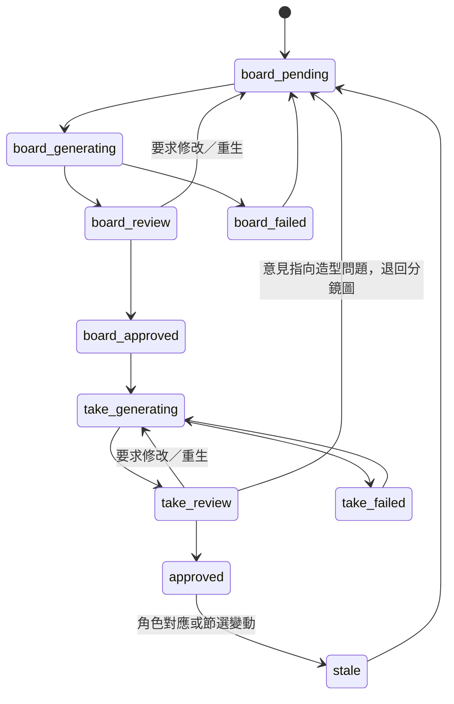

# AniRecast 技術設計（草稿 v0.5）

搭配 [prd.md](prd.md) 閱讀。這份文件記錄「怎麼做」；需求、驗收標準和待決問題以 PRD 為準。平台：macOS 先做，Windows 在 M7；Workspace 格式從第一天起就跨平台。

## 1. 架構總覽

```mermaid
flowchart TB
  subgraph Sandbox[Codex 沙箱：關閉網路，只能寫 Workspace]
    CX[Codex agent]
    C[anirecast CLI<br/>在行程內使用 core]
  end
  subgraph Daemon[AniRecast daemon（launchd 常駐，在沙箱外）]
    API[HTTP API + SSE<br/>只給 Web，只聽 127.0.0.1]
    TAIL[events 追蹤器]
    JOB[Job runner<br/>生成通道 / agent 通道]
    PROV[Provider 轉接層<br/>Gemini Interactions / Files API]
    MEDIA[Media：ffmpeg / ffprobe / sharp]
    PY[Python sidecar<br/>分鏡偵測]
    DL[yt-dlp + deno]
    DISP[Codex 派發器<br/>codex app-server JSON-RPC stdio]
  end
  W[Web UI<br/>React SPA] -- HTTP / SSE --> API
  CX -- shell --> C
  C -- SQLite 交易：狀態變更、排 job、寫 events --> WS
  API -- core --> WS
  WS[(Workspace 資料夾<br/>anirecast.db（WAL）+ 媒體檔 + AGENTS.md)]
  TAIL -- 每 250ms 讀新 events --> WS
  TAIL --> API
  JOB -- 撈 queued job --> WS
  JOB --> PROV & MEDIA & PY & DL
  PROV -.讀金鑰.-> CFG[(~/.config/anirecast<br/>金鑰與本機設定)]
  DISP -- thread/start、turn/start --> CX
```



**原則**

- **只有 `packages/core` 會直接碰資料庫。** CLI 和 daemon 都在自己的行程內呼叫 core，用短交易寫入；兩邊都設 `busy_timeout`。
  - Schema 遷移只由 daemon 執行；CLI 發現 schema 版本不符時拒絕操作，並提示更新。
  - CLI 不經過網路，也不經過 daemon。實測在 Codex 沙箱裡（關閉網路）連 localhost HTTP 或 Unix socket 都會失敗，寫 Workspace 裡的 SQLite 則可以（research/codex-dispatch-visibility.md）。
- **Daemon 是唯一的 job runner，也是唯一會連網路的行程。** 模型呼叫、下載、上傳都只在 daemon 裡做。CLI 只負責排 job（`jobs` 表），用 `--wait` 時輪詢 job 狀態。
  - 所以 Codex 在沙箱裡**實際上就無法**打 Gemini，金鑰集中管理也就真的被強制執行了。
- **CLI 絕不自己啟動 daemon。**
  - 原因：在沙箱裡啟動的 daemon 會繼承沙箱，連不到 Gemini。
  - 做法：daemon 每 2 秒寫一次心跳。CLI 發現心跳過期時回傳錯誤 `daemon_not_running`，並附上啟動方式。CLI 可以用 `CODEX_SANDBOX` 環境變數判斷自己在不在沙箱裡。
  - Mac 上由 `anirecast setup` 安裝 launchd LaunchAgent，登入後自動啟動、掛掉自動重啟。
- **所有狀態變更都寫一筆 `events`**：與變更寫在同一個交易裡，不論是 CLI 還是 daemon 寫的。daemon 每 250ms 讀新的 events，推給 Web 的 SSE。這同時是稽核紀錄；CLI 的 `jobs watch` 也讀這張表。
- **Codex 的工作目錄 = Workspace 根目錄。** 建立 Workspace 時寫入 `AGENTS.md`；每台電腦把 Workspace 加為 Codex 桌面端專案一次。這一步同時解決兩件事：手動模式下 CLI 有權限寫入，自動派發的 thread 也會出現在側邊欄。
- **所有模型呼叫都由系統執行**：成本帳本、重試、併發限制都在同一個地方；Web 不需要經過 Codex 也能直接按「重生」。Codex 的角色是理解意見、修改提示詞與參考、排 job、檢查結果。
- **Workspace 是唯一的資料真相。** Daemon 一次開一個 Workspace，切換時重新載入。

## 2. 技術棧

| 層 | 選擇 | 理由 |
| --- | --- | --- |
| 語言／執行環境 | TypeScript、Node.js ≥ 24 LTS（本機目前是 26） | 你偏好 Node/TS；daemon、CLI、Web 共用型別 |
| Monorepo | pnpm workspaces | 本機已有 pnpm 11 |
| HTTP 服務（只給 Web） | Hono + `@hono/node-server`，用 zod 驗證，SSE 推事件 | 輕、型別好；請求與回應 schema 和 core 共用 |
| 資料庫 | **SQLite（WAL）+ Node 內建 `node:sqlite` + 手寫 SQL 遷移檔，不用 ORM**（S1 定案） | 本機單檔，跟著 Workspace 搬走；CLI 和 daemon 兩個行程同時存取，WAL 支援。實測在 Codex 沙箱內可以寫入；沒有原生模組，Windows（M7）不用編譯；資料表約 20 張，不需要 ORM |
| 背景任務 | 自製 SQLite `jobs` 表 + daemon 內 worker，分通道：生成通道（Gemini 依模型限流）、媒體通道（ffmpeg）、agent 通道（Codex 一次一輪） | 不需要 Redis；daemon 重啟後任務還在。分通道是為了避免死鎖：agent 那一輪會用 `--wait` 等生成 job 完成，兩者不能共用同一個併發名額 |
| 服務常駐 | macOS：launchd LaunchAgent（`setup` 安裝，KeepAlive）；Windows：M7 | daemon 必須在沙箱外、開機就在 |
| Web | React 19 + Vite + TanStack Router + TanStack Query + shadcn/ui（Radix + Tailwind CSS v4）+ lucide 圖示；本機 UI 狀態用 Zustand | 目前 React 生態的主流組合；這是本機 SPA，不需要 Next.js 的伺服器端功能 |
| 影片播放／時間軸 | 原生 `<video>` + `requestVideoFrameCallback` 自製逐幀控制和時間軸；對比用 canvas（見 §7.6）；P1 圖上框選用 Konva | 需要逐幀精度，現成播放器很難做到 |
| CLI | `commander` + 在行程內使用 `packages/core`（直接讀寫 Workspace 的 SQLite，不經網路）；stdout 輸出 JSON | 在 Codex 沙箱關閉網路時也能用；和 `rvfx`、`plate` 的 CLI 慣例一致 |
| 媒體處理 | 系統的 ffmpeg/ffprobe（本機 9.0.2）；圖片縮圖用 `sharp` | ffmpeg 是逐幀裁切、轉碼、合成的唯一可靠選擇 |
| 分鏡偵測 | Python sidecar（uv 管理）：PySceneDetect `AdaptiveDetector`；P1 加 TransNetV2 | 偵測的成熟函式庫在 Python 生態；sidecar 用 JSON 進出，換演算法不影響 TS 端 |
| 同一人識別 | 同一個 Python sidecar：`dghs-imgutils`（MIT）的動漫頭部／人物偵測與 CCIP 角色相似度（ONNX、CPU 可跑）；scikit-learn 做帶約束的聚合式分群 | CCIP 是專門比對「是不是同一個動漫角色」的模型；用頭部特徵降低換裝的影響。Python 版本固定在 onnxruntime 有提供 wheel 的版本（本機預設的 3.14 不一定有），由 uv 管理 |
| 下載 | yt-dlp（`uv tool` 安裝）+ deno（YouTube 的 JS 驗證需要） | 支援網站最多；由 `doctor` 管理版本 |
| 模型 SDK | `@google/genai`（Interactions API、Files API），包在 Provider 介面後面 | 實測過的路徑；之後換模型或換供應商只需要改轉接層 |
| Codex 派發 | 直接以 JSON-RPC 透過 stdio 驅動 `codex app-server`（約 40 行，已實測），不用 `codex exec`，也不用沒驗證過 thread 來源標記的包裝 SDK | 只有 app-server 建立的 thread 會被標成互動型、出現在桌面端；見 research/codex-dispatch-visibility.md |
| 視覺分析 | Gemini Flash 系列（M0 時選定並固定一個版本，例如 `gemini-3.8-flash`），設定檔可以改 | 角色偵測、位置框、分鏡描述 |
| 測試 | Vitest（單元／整合）、Playwright（Web 端到端） | |

## 3. Repo 結構

```text
AniRecast/
├── apps/
│   ├── daemon/          # Hono API、SSE、job worker
│   └── web/             # React SPA（daemon 在正式模式下直接提供它的靜態檔）
├── packages/
│   ├── core/            # 領域模型、狀態機、Drizzle schema 與遷移、Workspace 讀寫
│   ├── shared/          # zod schema、API 型別、錯誤碼（daemon / web / cli 共用）
│   ├── cli/             # anirecast CLI
│   ├── media/           # ffmpeg 封裝：probe、clip、conform、concat、hstack
│   └── providers/       # Gemini 轉接層：ImageGen、VideoEdit、VisionAnalyze、成本計算
├── python/              # uv 專案：anirecast-py（分鏡偵測、角色偵測、CCIP 特徵與分群）
├── skills/anirecast/    # Codex skill 原始碼（SKILL.md + reference.md）
├── .trellis/            # 開發流程（tasks / spec / workflow）
└── AGENTS.md
```

安裝（macOS）：從主 checkout 執行 `pnpm install && pnpm anirecast setup`。`setup` 會：

- 建 Python 環境；
- 檢查 ffmpeg（Homebrew）、yt-dlp（`uv tool`）和 deno；
- 把 CLI 連到 `~/.local/bin/anirecast`、把 skill 連到 `~/.codex/skills/anirecast`；
- 安裝並載入 launchd LaunchAgent（`~/Library/LaunchAgents/`，日誌寫到 `~/Library/Logs/AniRecast/`）。

之後直接用 `anirecast doctor` 檢查。Windows 的安裝方式在 M7 定。

## 4. Workspace 資料夾規範

```text
<任意名稱>/                         # 這台 Mac 的預設：/Users/alex/Documents/lien/mediaHub
├── anirecast.workspace.json        # manifest：格式版本、workspaceId、建立時間、最低系統版本
├── anirecast.db                    # SQLite（WAL），所有索引與狀態（路徑一律相對 Workspace 根目錄）
├── AGENTS.md                       # 給 Codex：用 anirecast CLI 操作、評審規則、禁止直接改媒體檔（系統產生，可更新）
├── library/
│   └── personas/<persona-slug>/
│       ├── persona.json            # 名稱、描述、標籤（DB 的鏡像，可讀、可重建）
│       └── refs/<ULID>.<ext>       # 參考圖原檔
├── sources/<source-id>/            # 下載合集
│   ├── source.<ext>                # 原始下載檔，不轉碼
│   └── info.json                   # yt-dlp 中繼資料（網址、標題、上傳者、時長…）
├── projects/<project-slug>/
│   ├── project.json                # 人看得懂的摘要
│   ├── clip/
│   │   ├── clip.mp4                # 逐幀精確的節選母版（固定幀率、高品質 H.264）
│   │   └── audio.wav               # 原音軌，合成時使用
│   ├── shots/<shot-id>/
│   │   ├── source.mp4              # 這個分鏡的原片段（上傳給 Omni 的就是它）
│   │   ├── frames/                 # 關鍵幀：first / mid / last / rep
│   │   ├── boards/b001.png + b001.json   # 分鏡圖版本 + provenance（提示詞、輸入雜湊、模型、成本）
│   │   └── takes/t001.mp4 + t001.json    # 分鏡視頻版本（已對齊幀率與解析度，無音軌）+ provenance
│   ├── renders/
│   │   ├── r001.mp4 + r001.json    # 成片 + 每個分鏡當時使用的版本
│   │   └── r001.compare.mp4        # 左右並排對比影片
│   └── exports/                    # 你手動匯出的檔案
├── cache/                          # 可重建：Web 代理檔、縮圖、波形、上傳暫存；匯出時排除
└── trash/                          # 刪除的東西先進這裡
```

規則：

- **Manifest 是「這是 AniRecast Workspace」的唯一判斷依據。** 打開時驗證 manifest 與 `anirecast.db` 的 schema 版本：舊版本先備份成 `anirecast.db.bak-<ts>` 再遷移；版本比系統新則拒絕開啟。
- **所有 DB 路徑都相對於 Workspace 根目錄，一律用 `/` 分隔**。
- **檔名跨平台規則**：Mac 和 Windows 之間會互搬，所以從第一天起就執行，core 寫檔前統一檢查。
  - 系統產生的名稱只用小寫 ASCII slug 或 ULID，中文和其他顯示名稱存在 DB；
  - 避開 Windows 保留名稱（CON、PRN、AUX、NUL、COM1–9、LPT1–9），不以 `.` 或空白結尾，不使用 `<>:"\|?*`；
  - 同一資料夾內不會有只差大小寫的兩個名稱；
  - 不使用符號連結，也不依賴 macOS 擴充屬性；
  - 單一路徑控制在 200 字元以內。
- **Provenance JSON 一旦寫入就不再修改**（版本只增不改）。DB 損毀時可以用 `anirecast workspace reindex` 從這些 JSON 重建大部分索引。
- **鎖檔** `.anirecast.lock`（記錄主機名稱、pid、時間）：發現另一台主機的鎖時唯讀開啟，並提示對方先關閉。
- **匯出**：`anirecast workspace export --to <dir|zip>` 先用 `VACUUM INTO` 產生一致的 DB 快照，再複製檔案、排除 `cache/`。直接複製資料夾也可以，但必須先在 AniRecast 裡關閉 Workspace（會做 WAL checkpoint）。
- **不放密鑰、不放絕對路徑、不放雲端暫存 ID 當真相**（Files API 的檔案約 48 小時就過期）。

## 5. 資料模型（主要資料表）

| 資料表 | 重點欄位 |
| --- | --- |
| `sources` | id、url、site、title、duration_ms、width、height、fps、file_path、info_path、status |
| `projects` | id、slug、name、source_id、status、generation_tier（draft／preview／final，預設 draft）、settings_json |
| `clips` | id、project_id、in_frame、out_frame、fps_num/den、file_path、audio_path、version、is_active |
| `shots` | id、clip_id、order_index、start_frame、end_frame、mode（`replace` 換角／`clean` 去字／`keep` 沿用原片／`exclude` 排除）、mode_source（auto／user）、remove_other_overlays（是否連片名與其他疊字一起去掉）、status、rep_frame、description、camera_json |
| `text_overlays` | id、shot_id、keyframe_id、bbox、text、category（`staff_credit`／`title_or_other`／`in_scene`）、remove（依類別預設，可以逐筆修改） |
| `keyframes` | id、shot_id、frame、role、path |
| `cast_members` | id、project_id、label、description、thumb_path、persona_id（null = 不替換）、status（active／not_a_character） |
| `looks` | id、cast_member_id、label、description、representative_tracklet_id、look_policy（`persona` 穿人設的衣服、留人設的髮型，為預設，Q8 已定案／`follow_source` 只換臉和特徵，保留原片服裝與髮型） |
| `tracklets` | id、shot_id、cast_member_id、look_id、identity_vec（頭部 CCIP 合成向量）、appearance_vec（全身）、confidence、assigned_by（auto／codex／user） |
| `detections` | id、tracklet_id、keyframe_id、head_bbox、body_bbox、attrs_json（Flash 外觀描述）、head_crop_path、body_crop_path |
| `cast_decisions` | id、kind（must_link／cannot_link／assign／not_a_character）、tracklet_a、tracklet_b 或 cast_member_id、source（codex／user）、locked、reason、confidence、at |
| `shot_cast_overrides` | shot_id、cast_member_id、persona_id 或 `keep` |
| `personas`／`persona_images` | 名稱、描述、標籤；圖片路徑、視角、是否為主圖 |
| `boards` | id、shot_id、version、status、path、prompt、model、params_json、inputs_json（路徑 + sha256）、parent_id、remote_json、cost_usd、created_by |
| `takes` | 同 boards，另加 board_id、tier（draft／preview／final）、segment_index、frames_in、frames_out、conform_json |
| `reviews` | id、target_type（board／take／render）、target_id、verdict（approve／changes／regenerate／keep_original）、comment、annotations_json |
| `agent_tasks` | id、kind（`review_feedback`／`cast_review`）、review_id、shot_id 或 project_id、payload_json（cast_review 的待判定項目與對照圖路徑）、status（open／claimed／done／needs_user／cancelled）、claimed_by、result_note、result_target_id |
| `codex_threads` | scope（`shot`／`project_cast`）、scope_id、thread_id、created_at |
| `codex_usage` | task_id、thread_id、tokens_json、at |
| `jobs` | id、type、lane（generate／media／agent）、payload_json、status、progress、error、attempts、cost_estimate、cost_actual、requested_by（user／codex:<thread_id>／system）、timestamps |
| `events` | seq（自增）、at、actor、kind、entity_type、entity_id、payload_json。與狀態變更寫在同一個交易，daemon 追蹤後推給 SSE |
| `daemon_heartbeat` | host、pid、version、at（每 2 秒更新；CLI 據此判斷 daemon 是否在跑） |
| `renders` | id、project_id、version、kind（draft／final）、path、compare_path、shots_snapshot_json |
| `cost_ledger` | id、job_id、model、usage_json、usd、at |

## 6. 狀態機

**分鏡（mode = replace）**



`mode = clean`（去字）的分鏡沒有分鏡圖階段，直接從 `take_generating` 開始，之後的評審、退回、通過都與上圖相同；它沒有「退回分鏡圖」這條路。

`mode = keep` 的分鏡直接視為完成，合成時使用原片段。

**處理方式的自動判定**（`mode_source = auto` 時；角色對應或字幕偵測一變就重算；你手動設過的分鏡不會被覆蓋）：
- 有對應到人設的片中角色 → `replace`；
- 否則，有任何 `remove = true` 的疊加字幕 → `clean`；
- 否則 → `keep`。

**Agent 任務**：`open → claimed → done`；或 `claimed → needs_user → open`（你回覆之後）；或 `cancelled`。`claimed` 超過 30 分鐘沒有回報時自動退回 `open`，避免卡住。

## 7. 生成管線

### 7.1 分鏡偵測
`clip.mp4` 交給 Python sidecar，用 AdaptiveDetector 產生剪接點（以幀號表示）。之後用 ffmpeg 輸出每個分鏡的 `source.mp4` 和關鍵幀，並把長度超過 10 秒的分鏡標示出來。

### 7.2 字幕辨識與分鏡描述
每個分鏡的 first、mid、last 三幀交給 Flash 視覺模型，輸出結構化 JSON，包含：
- **疊加字幕清單**：文字、位置框、類別。
  - `remove` 預設：工作人員字幕為 true，片名與其他疊字為 false，場景內文字固定為 false。
  - 三幀的結果合併：任何一幀出現就算這個分鏡有。
- 每個人物的外觀描述（髮色、髮型、眼睛、服裝、配件），以位置框對應到 §7.2a 偵測到的人物。
- 分鏡描述。

字幕類別判錯時，可以在 Web 上逐筆修改。

### 7.2a 同一人識別（程式 → Codex → 人）

目標：同一個人就算換了服裝或髮型，也歸到同一個 `cast_member`；兩個長得像的不同角色不能被併在一起。

**第 1 層：程式（Python sidecar，`imgutils`，MIT 授權，ONNX 在 CPU 上跑）**

1. **取樣**：每個分鏡取 first、mid、last 三幀，超過 3 秒的分鏡每秒多取 1 幀。
2. **偵測**：用 imgutils 的動漫**頭部**偵測（官方說最穩定）和**人物**偵測，得到頭部框和全身框，並以位置把頭部對應到所屬的人物。
3. **串成出場片段**：同一分鏡內相鄰取樣幀之間，用框的重疊度加 CCIP 相似度做匹配，把同一個人串成一個出場片段 `tracklet`。同一出場片段內的偵測必定是同一人。
4. **特徵**：
   - 身份特徵：頭部裁切的 CCIP 向量，再用 `ccip_merge` 合成出場片段的代表向量。用頭部而不用全身，是為了降低服裝的影響。
   - 外觀特徵：全身裁切的 CCIP 向量，只用來分造型。
   - CCIP 一次只能處理單一角色的圖，所以都先裁切再算。
5. **約束**：
   - 不可連結：同一分鏡中同時出現的兩個出場片段，一定不是同一人。
   - 必須連結／不可連結：你鎖定過的人工決定（§5 `cast_decisions`）。
6. **分群**：在約束下做聚合式分群。距離是 CCIP difference，門檻起點是模型預設值（`ccip_default_threshold()`，預設模型約 0.178），M0 再校正。
   - 每個歸屬的信心，取「到所屬群的距離」與「到最近的其他群的距離」之間的差距。
7. **分造型**：在每個 `cast_member` 底下，用全身特徵加 Flash 的服裝與髮型描述，再分一次群，得到 `looks`。

**第 2 層：Codex 判斷（agent 通道，自動派發）**

程式分完群之後，把需要判斷的項目整理成一筆 `cast_review` Agent 任務：
- 兩群距離接近門檻：可能是同一人換了裝；
- 群內差異大：可能混了兩個人；
- 只出現一次的出場片段；
- 信心低於門檻的歸屬。

每個項目附一張**對照圖**（daemon 用 sharp 拼好：各群的頭部和全身裁切、分鏡序號）和 Flash 的外觀描述，以 `localImage` 交給 Codex。

Codex 用 CLI 做決定：`anirecast cast merge|split|assign --reason "…" --confidence 0.x`。決定記為 `source = codex`。
- CLI 判斷操作者的方式：環境變數裡有 `CODEX_THREAD_ID` 就是 Codex，不會鎖定；沒有就是你，自動鎖定。在 Web 上的操作一律算你的。

- 派發到每個項目一個 thread：「AniRecast · <項目> · 角色辨識」。
- 每批最多 N 個項目，避免一輪太長。

**第 3 層：人工矯正（Web 角色表）**
- 你的修改記為 `source = user`，並且 `locked = true`。
- 之後重跑第 1、2 層時，這些決定是硬約束：不會被程式或 Codex 推翻，也不會再送給 Codex 判斷。

**重算的影響**：任何歸屬變動都寫進 `events`，觸發 §6 的處理方式重算；受影響、已通過的分鏡圖和分鏡視頻標為 `stale`。

### 7.3 分鏡圖（Nano Banana 2.1）
- 輸入：代表幀、對應人設的參考圖（每次請求的角色圖合計 ≤5 張，所以一個分鏡兩個人設時，每個人設最多 2 張）。
- 提示詞模板：「Image 1 是原分鏡；Image N 是角色 X 的參考。把 <位置／外觀描述> 的人換成 X，其他保持不變：構圖、姿勢、光線、背景、畫風」，再加上你和 Codex 的修改意見。
- 有要去掉的疊加字幕時，加上：「去掉位於 <bbox> 的疊加文字（<文字內容>），補上原本被遮住的背景；場景裡的文字保持不變」。
- 依該出場片段所屬造型的 `look_policy` 調整提示詞：
  - `persona`（預設）：「服裝與髮型用參考圖的樣子」。人設圖要有清楚的全身服裝，每次請求都附上全身主圖，讓所有分鏡的服裝一致。
  - `follow_source`：「只換人物身份（臉、髮色、眼睛、特徵），服裝與髮型保持 Image 1 的樣子」。
- 只有 `replace` 分鏡生成分鏡圖。
- 預設輸出 16:9、2K。
- 你要求修改時，Codex 可以選擇用 `previous_interaction_id` 做多輪修改（便宜、穩定），或從頭生成。兩種方式都會在 provenance 裡留下可以完整重放的輸入。

### 7.4 分鏡視頻（Omni 編輯）
1. **前處理**：把 `source.mp4` **重新標記為 24fps 固定幀率**（只改時間戳，幀數不變），再上傳到 Files API。上傳的 URI 存進 cache，48 小時內可以重用。
   - 上傳 720p 還是原始的 1080p，M0 比較後決定。
2. **請求**：
   - `replace`：`[video uri, 通過的分鏡圖, 人設主圖…, 文字]`。提示詞依官方建議保持簡短：「Replace … with the character in <IMAGE_REF_0>. Remove the overlaid credit text at <位置>. Keep everything else the same: motion, timing, camera, background, lighting, style, in-scene text.」
   - `clean`：`[video uri, 文字]`：「Remove the overlaid credit text at <位置>. Keep everything else the same.」
   - `response_format.resolution` 依**生成檔位**決定（PRD F9）：

     | 檔位 | Omni 輸出 | 上傳的輸入 | 對齊後尺寸 |
     | --- | --- | --- | --- |
     | `draft` | `360p`（`480p` 已實測被 API 拒絕） | 640×360 | 640×360 |
     | `preview` | `720p` | 1280×720 | 1280×720 |
     | `final` | `1080p`（**S11 定案**：原生 1080p 比 720p 用 lanczos 放大明顯銳利；每秒約 8,680 token、約為 720p 的 1.45 倍） | 1280×720 | 1920×1080 |

   - `takes.tier` 記錄檔位。
   - 「升級」是一個新的 take：沿用上一檔 take 的 `inputs_json` 和提示詞，只換檔位；`parent_id` 指向上一檔的 take，結果需要再次評審。
   - 合成時，成片的檔位等於所有被採用 take 的最低檔位；正式成片要求全部是 `final`。
3. **校驗**：輸出幀數必須等於輸入幀數；不相等時標示 `conform_mismatch`，不允許通過（可重試）。
4. **對齊**：把時間戳改回原幀率（例如 23.976），統一成 1920×1080，去掉音軌，存成 `takes/tNNN.mp4`。
5. **超過 10 秒的分鏡**：拆成 ≤10 秒的段，從第 2 段起加上前一段輸出的尾幀作為額外參考，生成後再接回。拆點優先選在動作較小的位置。

### 7.5 合成
依分鏡順序取「通過版本」或原片段，統一成 1920×1080 後用 ffmpeg concat 接起來（統一編碼參數，重新編碼一次），再 mux 上 `clip/audio.wav`。來源不是 1080p 時，原片段也一起縮放到 1080p。草稿合成會在畫面角落加上「草稿」浮水印。合成完成後驗證總幀數與節選相同、解析度是 1920×1080。

### 7.6 對比
- **匯出檔**：ffmpeg `hstack` 把原片和成片左右並排，附原音軌。
- **互動滑塊**：daemon 預先產生一支「上半原片、下半成片」的 `vstack` 代理檔（存在 cache）。Web 只用**一個** `<video>` 解碼，canvas 依滑塊位置從上半畫左邊、從下半畫右邊。兩邊來自同一個解碼幀，所以一定逐幀同步。兩個 `<video>` 各自播放會漂移，不採用。單一分鏡評審用同一個元件。

## 8. Codex 整合

### 8.1 為什麼是 CLI + Skill，而不是 MCP

| 考量 | CLI + Skill | MCP |
| --- | --- | --- |
| 你目前的工具慣例 | `rvfx`、`plate`（video-hub）都是 CLI + skill，一致 | 新模式 |
| 換電腦 | 裝好系統就能用；skill 由 `setup` 安裝 | 每台電腦都要在 `~/.codex/config.toml` 註冊 server |
| 長任務（生成 60 秒以上、批次數分鐘） | `--wait`、`jobs watch --jsonl` 很自然 | 工具呼叫有逾時限制，得自己做輪詢工具 |
| 除錯與手動操作 | 你自己也能直接在終端機跑同一條指令 | 要經過 MCP 客戶端 |
| 型別化的工具描述 | 靠 skill 文件和 `--help` | 原生支援 |

結論：先做 CLI + Skill。MCP 之後可以做成薄轉接層（`anirecast mcp`），重用同一套 API，不另外寫邏輯。

### 8.2 指令草案

```text
anirecast doctor | setup | serve | daemon start|stop|status
anirecast workspace init <dir> | open <dir> | status | export --to <dir|zip> | reindex
anirecast source add <url> [--wait] | list | show <id> | rm <id>
anirecast project create --source <id> --name <name> | list | show <p>
anirecast clip set <p> --in 00:01:23.500 --out 00:01:53.000 [--confirm]
anirecast shots detect <p> [--threshold n] | list <p> | split <p> <shot> --at <frame> | merge <p> <a> <b> | set <p> <shot> --mode keep|replace|exclude --rep-frame <n>
anirecast cast analyze <p> | list <p> [--looks] | assign <tracklet> --to <cast> | merge <a> <b> | split <cast> --tracklets … | not-character <tracklet> | rename <cast> <name>  (共用 --reason "…" --confidence 0.x；人工操作自動 lock)
anirecast cast map <p> <cast> --persona <id>|--keep | look-policy <look> follow_source|persona
anirecast persona add --name … --ref a.png --ref b.png | list | show | edit | archive
anirecast board generate <p> [<shot>…|--all] [--prompt-file f] [--from <boardId>] [--budget 5] [--wait]
anirecast take generate <p> [<shot>…|--all] [--prompt-file f] [--wait]
anirecast review list <p> [--pending] | approve|request-changes|keep-original <targetId> [--comment …]
anirecast tasks next [--claim] | list [--open] | done <taskId> --note "…" --result <id> | ask <taskId> --question "…"
anirecast render <p> [--draft] [--compare] [--wait]
anirecast jobs list | show <id> | watch [--jsonl] | cancel <id> | retry <id>
anirecast cost <p> [--shot <id>]
```

輸出規範：stdout 只輸出一個 JSON 物件，格式為 `{ ok, data | error: { code, message, hint } }`；進度寫到 stderr；結束碼區分「使用者錯誤」「暫時性錯誤」「被模型拒絕」。

### 8.3 Skill 內容重點（`skills/anirecast/SKILL.md`）
- 流程地圖與每個階段的前置條件。
- 「處理評審」標準流程：`tasks next --claim` → 看圖（原代表幀、目前版本、意見）→ 修改提示詞或參考 → `board|take generate --from … --wait` → 自己看結果 → `tasks done --note`。
- 邊界：不能代替你按「通過」；成本超過預算時停下來問；被內容過濾擋下時最多改寫 2 次，仍然失敗就用 `tasks ask` 回報。

### 8.4 交接模式

**自動派發（MVP 預設）**：daemon 監聽新的 `agent_tasks`，透過 `codex app-server` 交給 Codex。

1. **找 codex 執行檔**：依序看設定檔指定的路徑 → 桌面版內建的 codex（macOS：`/Applications/ChatGPT.app/Contents/Resources/codex-cli/bin/codex`；Windows 在 M7 確認）→ PATH，取版本最新的那個。
   - 實測 PATH 上的 0.156 會因為 `config.toml` 的模型被拒絕，所以不能直接用 PATH。
   - `doctor` 和設定頁會用選到的執行檔真的跑一輪探測，把錯誤原文顯示出來。
2. **啟動**：daemon 常駐一個 `codex app-server` 子程序，程序掛掉就重啟。
   - `initialize` 時設 `clientInfo.name = "anirecast"`、`capabilities.experimentalApi = true`，專案歸屬需要用到實驗性 API。
   - **啟動自我檢查**：`project/list` 能呼叫，而且找得到根目錄等於 Workspace 根目錄的專案 → 記下該專案的 `projectId`。
     - 找不到專案時：Web 和 `doctor` 提示「請在 Codex 桌面端把 Workspace 資料夾加為專案」。
     - `project/list` 不能用（例如 Codex 改版）：降級，thread 不指派專案，會出現在桌面端的「最近項目」，Web 的「在 Codex 打開」照常可用，並顯示降級警告。
3. **thread 對應**：資料表 `codex_threads(scope, scope_id, thread_id, created_at)`。
   - 評審意見：一個分鏡一個 thread。
   - 同一人識別的 Codex 判斷：一個項目一個 thread，命名為「AniRecast · <項目> · 角色辨識」。
   - Codex 紀錄只要求在本機桌面端看得到，不處理跨電腦遷移。
   - 該分鏡還沒有 thread 時：
     - `thread/start`：cwd 是 Workspace 根目錄、`projectId` 是第 2 步找到的專案、`sandbox: workspace-write`、`approvalPolicy: never`。
     - 用 `thread/name/set` 命名為「AniRecast · <項目> · <分鏡序號>」。
     - 再讀一次 thread，確認 `projectId` 已經寫上；沒寫上就補呼叫 `thread/metadata/update { threadId, projectId }`。後者已實測可以讓 thread 出現在桌面端專案底下。
   - **只看 cwd 不夠**：實測桌面端不會依工作目錄自動把外部建立的 thread 歸進專案，一定要明確指派 `projectId`。
   - 每一輪的 `turn/start` 都明確帶上 `sandboxPolicy: { type: workspaceWrite, networkAccess: false, writableRoots: [<Workspace 根目錄>] }`。Codex 只能寫 Workspace、不能連網，靠 CLI 寫 SQLite 和 daemon 溝通（已實測可行）。
   - 已經有 thread 時：`thread/resume`。
   - `thread/resume` 失敗時（例如 thread 被刪掉），直接開一個新 thread，不另外補前幾輪的內容。
4. **一輪處理**：`turn/start` 的輸入包含：
   - `skill`：指向 repo 內 `skills/anirecast` 的路徑。明確指定，不依賴每台電腦都裝好 skill。
   - `localImage`：原代表幀、目前版本，以及你框選的區域截圖。
   - `text`：任務 id、分鏡資訊、你的意見。
5. **進度與紀錄**：
   - `item/*` 事件（包括 `item/agentMessage/delta`）透過 SSE 轉給 Web 即時顯示。
   - `thread/tokenUsage/updated` 寫進 Codex 用量帳本；`account/rateLimits/updated` 用來判斷額度、必要時暫停派發。
   - 一輪結束時，只把 `tasks done --note` 的一句說明和 thread id 存進 DB，給 Web 的版本歷史顯示和連結；完整過程留在 Codex 桌面端。
6. **併發**：agent 通道一次只跑一輪；同一分鏡處理中時，新的意見排在後面。
   - agent 通道與生成通道分開：Codex 那一輪會執行 `board generate --wait` 等生成完成，兩者共用名額會互相卡死。
   - CLI 從環境變數 `CODEX_THREAD_ID` 取得 thread id，記進 `jobs.requested_by` 和版本的 `created_by`，Web 就能從版本連回 Codex thread。
7. **「在 Codex 打開」**：連結是 `codex://threads/<thread_id>`。官方沒有文件，**macOS 桌面版 26.1013 實測可用**。連結打不開時，改為提供可複製的 thread id 和 `codex resume <id>` 指令。
8. **處理中**：Web 顯示鎖定提示，提醒不要在桌面端對同一個 thread 發訊息，避免兩個程序同時寫入。

**手動模式（備用）**：在 Codex 桌面端打開 **Workspace 專案**，說「處理評審」，Codex 依照 Workspace 的 `AGENTS.md` 和 skill，用 `anirecast tasks next --claim` 處理。設定裡可以暫停自動派發。
- 必須在 Workspace 專案裡操作：如果在 repo 專案裡開對話，Workspace 不在可寫範圍內（除非該 thread 關閉沙箱），CLI 會寫不進 DB。CLI 遇到這種情況要回報明確的錯誤。

**每台電腦一次性設定**：在 Codex 桌面端把 Workspace 資料夾加為專案。

- 效果：AniRecast 因此拿得到專案 id，派發出去的 thread 會出現在這個專案底下；手動模式也有寫入權限。
- `doctor` 透過 app-server 的 `project/list` 檢查，不讀桌面端的內部檔案。
- 實驗性的 `project/create` 也許能讓 AniRecast 自動建立這個專案，省掉手動那一步。M3 再驗證，確認桌面端會顯示才採用。

## 9. Web 頁面

| 頁面 | 內容 |
| --- | --- |
| Workspace 選擇 | 新建、打開、最近使用；顯示驗證結果 |
| 下載合集 | 貼連結下載、清單、預覽、建立項目 |
| 素材庫 | 人設卡片牆、編輯人設、上傳參考圖 |
| 項目總覽 | 進度條（節選 → 分鏡 → 角色 → 分鏡圖 → 分鏡視頻 → 成片）、成本 |
| 原片與節選 | 播放器、逐幀控制、入點／出點、確認節選 |
| 分鏡 | 分鏡卡片格狀列表（縮圖、時長、角色標籤、狀態）；拆分、合併、邊界調整 |
| 角色表 | 片中角色 ↔ 人設對應；出場分鏡 |
| 評審台 | 以分鏡為單位：左邊原片，右邊目前版本，下方版本歷史與 Codex 說明；鍵盤快捷鍵（A 通過、R 要求修改、→ 下一鏡） |
| 成片 | 滑塊對比播放器、草稿／正式成片版本、匯出 |
| 任務中心 | 背景任務、Agent 任務、成本帳本 |

## 10. 設定與密鑰

- 本機設定：`~/.config/anirecast/config.json`，內容包含：
  - 預設模型 ID、併發數、最近使用的 Workspace；
  - 自動派發開關、`codex.binPath`（不設定時自動尋找）、`codex.model`（不設定時沿用該電腦 `~/.codex/config.toml` 的設定）。
- 金鑰：環境變數 `GEMINI_API_KEY`（也接受 `GEMINI_OMNI_API_KEY`），或 `anirecast auth set-key` 寫進 macOS 鑰匙圈。repo 裡的 `.env` 只給開發用，已經加進 `.gitignore`。
- 模型 ID 不寫死在程式碼裡：`models.image = gemini-nano-banana-2.1`、`models.video = gemini-omni-1.1-flash`、`models.vision = <M0 選定>`。

## 11. 留給 M0 確認的技術點

- 23.976fps 的影片重新標成 24fps 上傳後，Omni 是否仍維持幀數一致（預期是，因為只改時間戳）。
- 極短分鏡要不要加前後緩衝幀一起送，回來再裁掉。
- 視覺模型的位置框精度是否足以支撐「多人同框只換一人」。
- 每次請求可以放幾張參考圖、參考圖順序與 `<IMAGE_REF_n>` 的對應關係。
- PySceneDetect 對閃白和快速剪輯的漏判率；是否需要 M1 就加入 TransNetV2。
- **去字**：
  - Omni 能不能乾淨地去掉工作人員字幕，包括字幕壓在角色身上、淡入淡出、捲動字幕的情況；
  - 場景內文字會不會被誤刪；
  - 換角和去字放在同一次請求，品質是否會比分兩次差。
- **1080p**：比較同一個分鏡的三種做法：
  - Omni `1080p` 輸出；
  - Omni `720p` 輸出加 ffmpeg lanczos 放大；
  - Omni `720p` 輸出加動漫超解析模型放大。
  - 比較項目：與原片相鄰分鏡的清晰度差異、價格、耗時。同時確認上傳 1080p 原片會不會改善結果。
- Flash 視覺模型分辨「疊加字幕」和「場景內文字」的準確度。
- **同一人識別**：用一段角色有換裝、換髮型的節選，人工標好正確答案，量測：
  - 只用程式分群（頭部 CCIP、全身 CCIP、兩者加權各一次）各歸對多少；
  - 加上 Codex 判斷之後歸對多少；
  - 校正分群門檻、送交 Codex 的信心門檻和每批數量；
  - 確認 imgutils 頭部偵測在 OP 常見的側臉、背影、遠景、動態模糊下的漏判率。
- imgutils 的實際套件版本、可用的 Python 版本，以及在 Apple Silicon 上用 CPU 跑一段 90 秒 OP 的耗時。

## 12. 留給 M7（Windows）確認的技術點

- Windows 桌面版內建 codex 的路徑與版本取得方式。
- Windows 上 Codex 沙箱的行為：關閉網路時，CLI 能不能寫 Workspace 的 SQLite（Mac 已實測可行）。
- `codex://threads/<id>` 連結：Mac 版的程式在 `win32` 平台會跳過 `setAsDefaultProtocolClient`，可能改由安裝程式註冊，需要實測。
- 服務常駐方式：工作排程器、啟動資料夾，或 Windows 服務。
- ffmpeg、deno、uv、yt-dlp 用 winget 安裝；SQLite driver 的原生模組要不要在 Windows 上編譯（若 M1 選 `node:sqlite` 就不用）。
- 從 Mac 搬來的 Workspace 直接打開（路徑分隔、大小寫、保留名稱等規則已在 §4 從第一天起執行）。

## 13. v0.6 增補（2026-10-25，M0 回饋）

### 13.1 項目流程

1. 片源
2. 節選
3. 分鏡
4. 角色
5. **角色設計**（新增）
6. 生成與評審
7. 成片

- 每一步都有上一步、下一步。
- `ProjectStep` 新增 `design`：所有已對應的人設都有核准的三視圖，這一步才算完成。

### 13.2 角色設計

- **單位**：每個（項目, 人設）三張圖，各自有版本、可評審，狀態流程和分鏡圖相同：
  - `turnaround`：正、側、背三視圖；
  - `expressions`：表情；
  - `poses`：動作，包含原角色在這支 OP 裡的動作類型。
- **輸入**（明確排序，最多 5 張參考圖）：
  1. 人設全身圖；
  2. 人設三視圖；
  3. 畫風參考 2 張：用**保留不換**的角色或廣角鏡頭，避免參考到要被換掉的角色；
  4. 被替換角色的身體裁切 1 張：只參考比例與畫法，不參考這個角色本身。
- **設計備註**：每個（項目, 人設）一段文字，例如 DeepSeek 的「遮肩、寬鬆」。這是項目內的改編，不修改素材庫。
- **輸出**：純色背景，不加任何文字或標籤。
- **下游使用**：
  - 分鏡圖用 [原幀, 設計三視圖, 設計表情]；
  - 分鏡視頻用 [分鏡圖, 設計三視圖]；
  - 沒有核准的設計時，退回素材庫參考圖；
  - 有設計之後，不再把帶有標籤文字的素材庫設定稿送進 Omni。
- **版本過期**：核准的設計版本記進 `replacementSignature`。設計換版，已核准的分鏡圖和分鏡視頻就會過期。
- **評審**：`reviews.target_type` 加 `design`；Codex 處理 `review_feedback` 時 `targetType: 'design'`、沒有 shotId。
- **資料表**：`designs`（project_id, persona_id, kind, version, status, prompt, model, params, inputs, path, error, cost, parent_id, created_by, created_at），唯一鍵為（project, persona, kind, version）。設計備註存在 `project_personas`（project_id, persona_id, note）。

### 13.3 畫風與光影

- **項目畫風描述**：每個項目做一次視覺分析（約 6 張關鍵幀），存成 `projects.style_notes`，內容包括線條、上色與陰影方式、配色、眼睛畫法。
- **分鏡光影**：分鏡分析新增 `lighting`，存在 `shots.lighting`。
- **注入**：角色設計、分鏡圖、分鏡視頻的提示詞都加入上述兩項，並要求新角色的打光和原角色一樣。

### 13.4 模型選擇與備援

- **圖片**：`models.image`、`models.design` 可以用 `fal:openai/gpt-image-2.5/sunburst/edit`（GPT Image 2.5 Sunburst，最多 16 張參考圖，以 billable units 計價）。
- **視頻**：`models.videoFallback`，例如 `fal:bytedance/seedance-2.5/us/reference-to-video`。主模型被安全過濾擋下、或連續失敗時，改用備援。
- **Seedance 的幀數對齊**：
  - 輸入不足 4 秒時，在尾端用定格補到 4 秒；
  - 輸出後裁回原長度；
  - 若輸出長度和輸入不同（速度有偏差），在 ±20% 以內依比例重新取樣到原幀數；超出就判定失敗。
  - provenance 記下用了哪種對齊方式。

### 13.5 分鏡之間的銜接（依優先順序）

1. **連續動作合併**：已完成，見切點判斷。
2. **同一個角色設計**：所有分鏡用同一套設計，角色長相一致。
3. **段落一起生成**：
   - 連續的換角／去字分鏡合成一段（10 秒以內），一次送 Omni，輸出再依原切點切回各個分鏡。Omni 會原樣保留段落內的切點和幀數（#50、#68 已驗證）。
   - 保留原片的分鏡會結束一個段落；JEV 判定換場景（`same_scene=false`）也會結束段落。
   - 補幀只補在段落尾端。
   - 被擋的段落改成逐個分鏡生成。
   - 分鏡視頻仍然逐個分鏡建立，以 `segment_id` 關聯，評審與核准方式不變。
4. **顏色統計對齊**：每個生成的分鏡對齊原片的色彩統計（ffmpeg，不需要額外請求）。原片的切點本來就銜接自然，各自對齊原片，銜接就跟原片一樣。
5. **鄰近分鏡錨定**：分鏡單獨生成時，加入上一個已核准分鏡視頻的最後一幀當參考。
6. **銜接檢查**：把原片和生成版的切點前後幀並排，交給 JEV 判斷角色、服裝、顏色是否一致；有問題的交給 Codex 處理，最後由人工在成片頁確認。

### 13.6 Codex 討論（導出／導入）

- **用途**：網頁上一句評審意見講不清的問題（例如一直被擋的分鏡、角色設計方向、整個項目的畫風），改成在 Codex 單獨開對話，討論好幾輪。
- **導出**：
  - 可以導出的對象：分鏡、分鏡圖或分鏡視頻的某個版本、角色設計、人設、角色、等待回覆的自動任務，或整個項目。
  - 導出時在 `projects/<slug>/codex/<id>/` 寫入 `BRIEF.md`（問題、現況、各版本和提示詞、圖片路徑、結論格式）和 `context.json`。
  - 同時在 Codex App 開一個具名對話，歸在 workspace 所屬的 project 底下。Codex 先讀資料、提出 2–3 個做法，然後停下來等人回覆。
  - 也可以複製提示詞，貼到任何 Codex 對話使用。
- **對話歸屬**：daemon 只負責第一輪。第一輪結束後 app-server 就關閉，之後不再 resume 這個 thread，避免兩個程序同時在同一個對話上執行 turn。後續討論在 Codex App 進行。
- **交回**：
  - Codex 把結論寫進 `result.json`，內容包括 `summary`、`actions`、`versions`，再執行 `anirecast codex submit <id>`。
  - submit 會檢查每個 id 都存在於這個項目，有問題就一次列出全部，讓 Codex 在對話裡修正。
  - 可以重複送出，以最後一次為準。
- **導入**：
  - 在討論頁逐項勾選。`approve` 預設不勾；需要送出模型請求的項目會標示「付費」。
  - 導入一定由人操作，Codex 會被拒絕。
  - 導入時走原本的排隊函式，所以預算、每日配額、安全擋下上限都照常生效；導入前不會改任何東西，也不會花錢。
  - 每一項各自成功或失敗；已成功的項目不會重複執行。
- **可導入的動作**：`design.note`、`design.generate`、`board.generate`、`take.generate`、`take.still`、`shot.mode`、`shots.merge`（不強制）、`style.notes`、`approve`、`task.answer`、`task.close`。場景重新設計完成後再加對應的動作。
- **資料表**：`handoffs`（schema v6），欄位為 id、project、target_type、target_id、topic、status（open → submitted → imported／closed）、dir、thread_id、result_json、applied_json。

### 13.7 外部參考：hypit（2026-10-25 評估）

- **結論**：hypit-ai/hypit 是用 Codex／Claude Code skill 加自家 DSL 做真人短影音的工具，不是動畫逐鏡換角。它的授權是改過的 Apache-2.0，禁止商業再散布，因此只借做法，不引入程式碼或依賴。
- **可借的做法**：
  - Seedance 提示詞分三段：每個參考負責什麼（subject）、從參考影片取什麼（transfer）、明確不要照抄什麼（exclude）。fal 的 Seedance 提示詞目前只有 `Edit @Video1.`，可以改成這種結構。
  - 項目共用的畫風區塊和每鏡的光影指示分開寫，不混在一起。這與 13.3 的注入方式一致。
  - hypit 寫的 Seedance 2.5 上限是 4–30 秒、30 張參考圖、10 支參考影片。若 fal 上查證一致，備援路線的段落可以超過 10 秒。

### 13.8 角色設計改為「綁定 → 原片分析 → 重新設計」（取代 13.2 的單位與輸入）

- **單位**：一份設計屬於一個綁定，也就是「原片角色 → 物料庫角色」，不屬於物料庫角色本身。`designs.cast_member_id`（schema v8）。
- **原片分析**（`design.analyze`，`cast_analyses`）：
  - 取原片角色在每個分鏡最清楚的頭部與全身裁切，最多 16 個，交給視覺模型。
  - 回傳四項：這部動畫怎麼畫她（畫風）、身形比例、服裝，以及她在 OP 裡實際出現的表情（最多 9 個）和動作（最多 6 個），每項都對應到一個分鏡的裁切。
  - 人可以取消勾選其中的表情或動作。
  - 出場改過或分鏡合併/拆分後，分析標為過期。
- **重新設計**：
  - **三視圖**：保留物料庫角色的身分；身形和畫法跟原片角色一致，參考她最大的兩張全身裁切和一張原片畫面。服裝依造型設定，用人設的服裝或沿用原片服裝。
  - **表情、動作**：照勾選的項目逐格重現。原片裁切由 daemon 拼成一張參考格，讓模型收到的角色圖維持在少數幾張。提示中要求只取表情或姿勢，不取背景。
- **下游**：分鏡圖、分鏡視頻、replacement signature、核准後的過期判定、步驟狀態都改為依綁定計算。合併角色時設計一併移動。
- **2026-10-25 Lycoris 實測**：千束與瀧奈的原片分析各約 USD 0.03。表情表與動作表確實重現了原片的表情和動作，例如瀧奈端茶盤、射擊姿勢、靠柱子、拎垃圾袋。三視圖的畫風變化不大，因為 Nano Banana 很貼近物料庫的畫法。

### 13.9 可選模型（Video-to-Video）

- **圖片**：Nano Banana 2.1（Google 直連）、GPT Image 2.5 Sunburst（fal）。
- **視頻**（輸入原片分鏡、輸出換角後的同一鏡）：Gemini Omni Flash 1.1（Google 直連）、Seedance 2.5（fal reference-to-video，`task: editing`）、MiniMax H3 Max Recast（fal）、Wan 3.0（fal reference-to-video）、Wan 2.7 Edit（fal）。
  - Wan 3.0 在 fal 只有 reference-to-video：把原片當參考影片（Video 1），分鏡圖和角色圖依序當 Image 1、2… 重新生成整段，不是逐幀編輯。
  - Wan 3.0 的 `duration` 只能是整秒：上傳時用最後一幀補到下一個整秒，指定同樣的秒數，輸出後依時間對齊再剪回分鏡的幀數。參考影片的秒數也計費。
  - 提示開頭固定是「Video 1 is the original anime shot. Remake it shot for shot…（鏡頭運動、構圖、時間、背景、光影、色彩、動作和畫風都照原片），只改下面這些」，後面接各角色的替換說明。
  - Wan 2.7 Edit 保留，因為它是真正的逐幀編輯。
- **每個模型的規格**（`VIDEO_MODELS`）：
  - 能收的參考圖：分鏡圖、每個新角色一張，或兩者都收。
  - 最短與最長輸入：H3 5 秒、Wan 2 秒、Seedance 2 秒。
  - 幀步：Omni 每 4 幀一組。
  - 對齊方式：Omni 依幀數對齊；其他模型依時間對齊。
- **短分鏡**：上傳時用最後一幀補到該模型的最短長度和幀步；輸出後再把補的部分剪掉。
- **依時間對齊**：把輸出縮放到上傳的長度，誤差在 ±20% 以內；然後重新取樣到原片幀率，取前 N 幀。超過 ±20% 就判定失敗，不硬拉。
- **選擇層級**：
  - 項目設定（`settings.models`）優先於 config 預設；
  - 每次生成也可以另選；
  - 網頁有總覽的「模型」卡，評審頁的生成按鈕旁也有選單。

### 13.10 整理角色（JEV）

- **`cast.tidy`**：JEV 看裁切拼圖，做三件事：
  1. 判斷角色表中哪些是同一人。
  2. 判斷同一角色的哪些造型其實是同一套服裝與髮型。
  3. 找出混進來的其他人。
- **自動合併**：信心 ≥ 0.85 才自動合併。保留已綁定物料庫角色的那一個；兩個角色綁定了不同的物料庫角色就不合併。
- **其餘交給 Codex**：信心不足的、被人鎖定的出場擋下的、混進來的出場，合成一個 `cast_review` 任務交給 Codex。
- **鎖定規則**：只有人（actor `user`）的決定會鎖定。Codex、JEV 等程式都算 AI 決定，人可以推翻。
- **Lycoris 實測**（約 USD 0.13）：
  - 瀧奈的造型從 17 個減到 13 個。
  - 找出瀧奈和フキ的出場裡混進的乙女櫻、千束出場中只拍到店門的一格，以及「角色 6」其實是千束和瀧奈。
