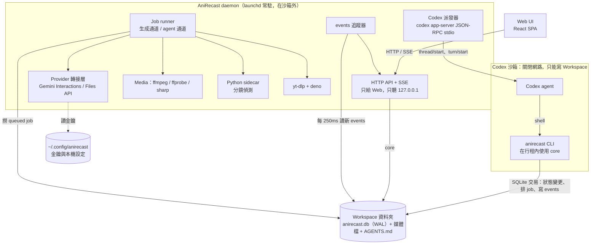
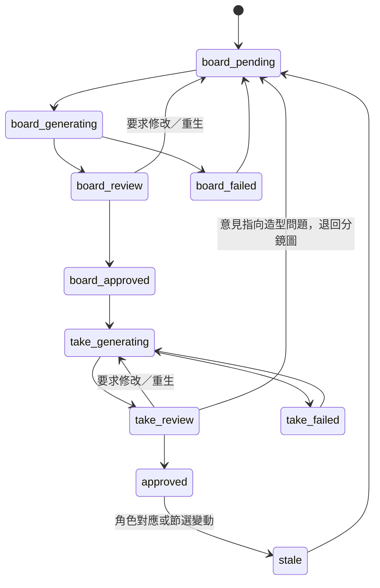

# AniRecast 技術設計（草稿 v0.3）

搭配 [prd.md](prd.md) 閱讀。這份文件記錄「怎麼做」；需求、驗收標準和待決問題以 PRD 為準。平台：macOS 先做，Windows 在 M7；Workspace 格式從第一天起就跨平台。

## 1. 架構總覽



**原則**

- **只有 `packages/core` 會直接碰資料庫。** CLI 和 daemon 都在自己的行程內呼叫 core，用短交易寫入；兩邊都設 `busy_timeout`。
  - Schema 遷移只由 daemon 執行；CLI 發現 schema 版本不符時拒絕操作，並提示更新。
  - CLI 不經過網路，也不經過 daemon。實測在 Codex 沙箱裡（關閉網路）連 localhost HTTP 或 Unix socket 都會失敗，寫 Workspace 裡的 SQLite 則可以（research/codex-dispatch-visibility.md）。
- **Daemon 是唯一的 job runner，也是唯一會連網路的行程。** 模型呼叫、下載、上傳都只在 daemon 裡做。CLI 只負責排 job（`jobs` 表），用 `--wait` 時輪詢 job 狀態。
  - 所以 Codex 在沙箱裡**實際上就無法**打 Gemini，金鑰集中管理也就真的被強制執行了。
- **CLI 絕不自己啟動 daemon。**
  - 原因：在沙箱裡啟動的 daemon 會繼承沙箱，連不到 Gemini。
  - 做法：daemon 每 2 秒寫一次心跳。CLI 發現心跳過期時回傳錯誤 `daemon_not_running`，並附上啟動方式。CLI 可以用 `CODEX_SANDBOX` 環境變數判斷自己在不在沙箱裡。
  - Mac 上由 `anirecast setup` 安裝 launchd LaunchAgent，登入後自動啟動、掛掉自動重啟。
- **所有狀態變更都寫一筆 `events`**：與變更寫在同一個交易裡，不論是 CLI 還是 daemon 寫的。daemon 每 250ms 讀新的 events，推給 Web 的 SSE。這同時是稽核紀錄；CLI 的 `jobs watch` 也讀這張表。
- **Codex 的工作目錄 = Workspace 根目錄。** 建立 Workspace 時寫入 `AGENTS.md`；每台電腦把 Workspace 加為 Codex 桌面端專案一次。這一步同時解決兩件事：手動模式下 CLI 有權限寫入，自動派發的 thread 也會出現在側邊欄。
- **所有模型呼叫都由系統執行**：成本帳本、重試、併發限制都在同一個地方；Web 不需要經過 Codex 也能直接按「重生」。Codex 的角色是理解意見、修改提示詞與參考、排 job、檢查結果。
- **Workspace 是唯一的資料真相。** Daemon 一次開一個 Workspace，切換時重新載入。

## 2. 技術棧

| 層 | 選擇 | 理由 |
| --- | --- | --- |
| 語言／執行環境 | TypeScript、Node.js ≥ 24 LTS（本機目前是 26） | 你偏好 Node/TS；daemon、CLI、Web 共用型別 |
| Monorepo | pnpm workspaces | 本機已有 pnpm 11 |
| HTTP 服務（只給 Web） | Hono + `@hono/node-server`，用 zod 驗證，SSE 推事件 | 輕、型別好；請求與回應 schema 和 core 共用 |
| 資料庫 | SQLite（WAL）+ Drizzle ORM / drizzle-kit 遷移。Driver 在 M1 決定：`better-sqlite3`（成熟，但需要原生模組），或 Node 內建的 `node:sqlite`（實測可用，Windows 不用編譯；Drizzle 0.45 沒有官方 driver，要接 sqlite-proxy） | 本機單檔，可以跟著 Workspace 搬走；CLI 和 daemon 兩個行程同時存取，WAL 支援 |
| 背景任務 | 自製 SQLite `jobs` 表 + daemon 內 worker，分通道：生成通道（Gemini 依模型限流）、媒體通道（ffmpeg）、agent 通道（Codex 一次一輪） | 不需要 Redis；daemon 重啟後任務還在。分通道是為了避免死鎖：agent 那一輪會用 `--wait` 等生成 job 完成，兩者不能共用同一個併發名額 |
| 服務常駐 | macOS：launchd LaunchAgent（`setup` 安裝，KeepAlive）；Windows：M7 | daemon 必須在沙箱外、開機就在 |
| Web | React 19 + Vite + TanStack Router + TanStack Query + shadcn/ui（Radix + Tailwind CSS v4）+ lucide 圖示；本機 UI 狀態用 Zustand | 目前 React 生態的主流組合；這是本機 SPA，不需要 Next.js 的伺服器端功能 |
| 影片播放／時間軸 | 原生 `<video>` + `requestVideoFrameCallback` 自製逐幀控制和時間軸；對比用 canvas（見 §7.6）；P1 圖上框選用 Konva | 需要逐幀精度，現成播放器很難做到 |
| CLI | `commander` + 在行程內使用 `packages/core`（直接讀寫 Workspace 的 SQLite，不經網路）；stdout 輸出 JSON | 在 Codex 沙箱關閉網路時也能用；和 `rvfx`、`plate` 的 CLI 慣例一致 |
| 媒體處理 | 系統的 ffmpeg/ffprobe（本機 9.0.2）；圖片縮圖用 `sharp` | ffmpeg 是逐幀裁切、轉碼、合成的唯一可靠選擇 |
| 分鏡偵測 | Python sidecar（uv 管理）：PySceneDetect `AdaptiveDetector`；P1 加 TransNetV2 | 偵測的成熟函式庫在 Python 生態；sidecar 用 JSON 進出，換演算法不影響 TS 端 |
| 下載 | yt-dlp（`uv tool` 安裝）+ deno（YouTube 的 JS 驗證需要） | 支援網站最多；由 `doctor` 管理版本 |
| 模型 SDK | `@google/genai`（Interactions API、Files API），包在 Provider 介面後面 | 實測過的路徑；之後換模型或換供應商只需要改轉接層 |
| Codex 派發 | 直接以 JSON-RPC 透過 stdio 驅動 `codex app-server`（約 40 行，已實測），不用 `codex exec`，也不用沒驗證過 thread 來源標記的包裝 SDK | 只有 app-server 建立的 thread 會被標成互動型、出現在桌面端；見 research/codex-dispatch-visibility.md |
| 視覺分析 | Gemini Flash 系列（M0 時選定並固定一個版本，例如 `gemini-3.8-flash`），設定檔可以改 | 角色偵測、位置框、分鏡描述 |
| 測試 | Vitest（單元／整合）、Playwright（Web 端到端） | |

## 3. Repo 結構

```text
AniRecast/
├── apps/
│   ├── daemon/          # Hono API、SSE、job worker
│   └── web/             # React SPA（daemon 在正式模式下直接提供它的靜態檔）
├── packages/
│   ├── core/            # 領域模型、狀態機、Drizzle schema 與遷移、Workspace 讀寫
│   ├── shared/          # zod schema、API 型別、錯誤碼（daemon / web / cli 共用）
│   ├── cli/             # anirecast CLI
│   ├── media/           # ffmpeg 封裝：probe、clip、conform、concat、hstack
│   └── providers/       # Gemini 轉接層：ImageGen、VideoEdit、VisionAnalyze、成本計算
├── python/              # uv 專案：anirecast-py（分鏡偵測）
├── skills/anirecast/    # Codex skill 原始碼（SKILL.md + reference.md）
├── .trellis/            # 開發流程（tasks / spec / workflow）
└── AGENTS.md
```

安裝（macOS）：從主 checkout 執行 `pnpm install && pnpm anirecast setup`。`setup` 會：

- 建 Python 環境；
- 檢查 ffmpeg（Homebrew）、yt-dlp（`uv tool`）和 deno；
- 把 CLI 連到 `~/.local/bin/anirecast`、把 skill 連到 `~/.codex/skills/anirecast`；
- 安裝並載入 launchd LaunchAgent（`~/Library/LaunchAgents/`，日誌寫到 `~/Library/Logs/AniRecast/`）。

之後直接用 `anirecast doctor` 檢查。Windows 的安裝方式在 M7 定。

## 4. Workspace 資料夾規範

```text
<任意名稱>/                         # 例如 ~/AniRecast-Workspace
├── anirecast.workspace.json        # manifest：格式版本、workspaceId、建立時間、最低系統版本
├── anirecast.db                    # SQLite（WAL），所有索引與狀態（路徑一律相對 Workspace 根目錄）
├── AGENTS.md                       # 給 Codex：用 anirecast CLI 操作、評審規則、禁止直接改媒體檔（系統產生，可更新）
├── library/
│   └── personas/<persona-slug>/
│       ├── persona.json            # 名稱、描述、標籤（DB 的鏡像，可讀、可重建）
│       └── refs/<ULID>.<ext>       # 參考圖原檔
├── sources/<source-id>/            # 下載合集
│   ├── source.<ext>                # 原始下載檔，不轉碼
│   └── info.json                   # yt-dlp 中繼資料（網址、標題、上傳者、時長…）
├── projects/<project-slug>/
│   ├── project.json                # 人看得懂的摘要
│   ├── clip/
│   │   ├── clip.mp4                # 逐幀精確的節選母版（固定幀率、高品質 H.264）
│   │   └── audio.wav               # 原音軌，合成時使用
│   ├── shots/<shot-id>/
│   │   ├── source.mp4              # 這個分鏡的原片段（上傳給 Omni 的就是它）
│   │   ├── frames/                 # 關鍵幀：first / mid / last / rep
│   │   ├── boards/b001.png + b001.json   # 分鏡圖版本 + provenance（提示詞、輸入雜湊、模型、成本）
│   │   └── takes/t001.mp4 + t001.json    # 分鏡視頻版本（已對齊幀率與解析度，無音軌）+ provenance
│   ├── renders/
│   │   ├── r001.mp4 + r001.json    # 成片 + 每個分鏡當時使用的版本
│   │   └── r001.compare.mp4        # 左右並排對比影片
│   └── exports/                    # 你手動匯出的檔案
├── cache/                          # 可重建：Web 代理檔、縮圖、波形、上傳暫存；匯出時排除
└── trash/                          # 刪除的東西先進這裡
```

規則：

- **Manifest 是「這是 AniRecast Workspace」的唯一判斷依據。** 打開時驗證 manifest 與 `anirecast.db` 的 schema 版本：舊版本先備份成 `anirecast.db.bak-<ts>` 再遷移；版本比系統新則拒絕開啟。
- **所有 DB 路徑都相對於 Workspace 根目錄，一律用 `/` 分隔**。
- **檔名跨平台規則**：Mac 和 Windows 之間會互搬，所以從第一天起就執行，core 寫檔前統一檢查。
  - 系統產生的名稱只用小寫 ASCII slug 或 ULID，中文和其他顯示名稱存在 DB；
  - 避開 Windows 保留名稱（CON、PRN、AUX、NUL、COM1–9、LPT1–9），不以 `.` 或空白結尾，不使用 `<>:"\|?*`；
  - 同一資料夾內不會有只差大小寫的兩個名稱；
  - 不使用符號連結，也不依賴 macOS 擴充屬性；
  - 單一路徑控制在 200 字元以內。
- **Provenance JSON 一旦寫入就不再修改**（版本只增不改）。DB 損毀時可以用 `anirecast workspace reindex` 從這些 JSON 重建大部分索引。
- **鎖檔** `.anirecast.lock`（記錄主機名稱、pid、時間）：發現另一台主機的鎖時唯讀開啟，並提示對方先關閉。
- **匯出**：`anirecast workspace export --to <dir|zip>` 先用 `VACUUM INTO` 產生一致的 DB 快照，再複製檔案、排除 `cache/`。直接複製資料夾也可以，但必須先在 AniRecast 裡關閉 Workspace（會做 WAL checkpoint）。
- **不放密鑰、不放絕對路徑、不放雲端暫存 ID 當真相**（Files API 的檔案約 48 小時就過期）。

## 5. 資料模型（主要資料表）

| 資料表 | 重點欄位 |
| --- | --- |
| `sources` | id、url、site、title、duration_ms、width、height、fps、file_path、info_path、status |
| `projects` | id、slug、name、source_id、status、settings_json |
| `clips` | id、project_id、in_frame、out_frame、fps_num/den、file_path、audio_path、version、is_active |
| `shots` | id、clip_id、order_index、start_frame、end_frame、mode（`replace`／`keep`／`exclude`）、status、rep_frame、description、camera_json |
| `keyframes` | id、shot_id、frame、role、path |
| `cast_members` | id、project_id、label、description、thumb_path、persona_id（null = 不替換） |
| `detections` | id、shot_id、keyframe_id、cast_member_id、bbox、attrs_json、confidence |
| `shot_cast_overrides` | shot_id、cast_member_id、persona_id 或 `keep` |
| `personas`／`persona_images` | 名稱、描述、標籤；圖片路徑、視角、是否為主圖 |
| `boards` | id、shot_id、version、status、path、prompt、model、params_json、inputs_json（路徑 + sha256）、parent_id、remote_json、cost_usd、created_by |
| `takes` | 同 boards，另加 board_id、segment_index、frames_in、frames_out、conform_json |
| `reviews` | id、target_type（board／take／render）、target_id、verdict（approve／changes／regenerate／keep_original）、comment、annotations_json |
| `agent_tasks` | id、review_id、shot_id、status（open／claimed／done／needs_user／cancelled）、claimed_by、result_note、result_target_id |
| `codex_threads` | shot_id、thread_id、created_at |
| `codex_usage` | task_id、thread_id、tokens_json、at |
| `jobs` | id、type、lane（generate／media／agent）、payload_json、status、progress、error、attempts、cost_estimate、cost_actual、requested_by（user／codex:<thread_id>／system）、timestamps |
| `events` | seq（自增）、at、actor、kind、entity_type、entity_id、payload_json。與狀態變更寫在同一個交易，daemon 追蹤後推給 SSE |
| `daemon_heartbeat` | host、pid、version、at（每 2 秒更新；CLI 據此判斷 daemon 是否在跑） |
| `renders` | id、project_id、version、kind（draft／final）、path、compare_path、shots_snapshot_json |
| `cost_ledger` | id、job_id、model、usage_json、usd、at |

## 6. 狀態機

**分鏡（mode = replace）**



`mode = keep` 的分鏡直接視為完成，合成時使用原片段。

**Agent 任務**：`open → claimed → done`；或 `claimed → needs_user → open`（你回覆之後）；或 `cancelled`。`claimed` 超過 30 分鐘沒有回報時自動退回 `open`，避免卡住。

## 7. 生成管線

### 7.1 分鏡偵測
`clip.mp4` 交給 Python sidecar，用 AdaptiveDetector 產生剪接點（以幀號表示）。之後用 ffmpeg 輸出每個分鏡的 `source.mp4` 和關鍵幀，並把長度超過 10 秒的分鏡標示出來。

### 7.2 角色辨識
每個分鏡的 first、mid、last 三幀交給 Flash 視覺模型，輸出結構化 JSON：人物清單（外觀、位置框、顯眼程度）和分鏡描述。接著把所有分鏡的人物裁切圖和描述一次交給模型歸併成角色表。最後由你在 Web 上確認、合併、拆分。

### 7.3 分鏡圖（Nano Banana 2.1）
- 輸入：代表幀、對應人設的參考圖（每次請求的角色圖合計 ≤5 張，所以一個分鏡兩個人設時，每個人設最多 2 張）。
- 提示詞模板：「Image 1 是原分鏡；Image N 是角色 X 的參考。把 <位置／外觀描述> 的人換成 X，其他保持不變：構圖、姿勢、光線、背景、畫風」，再加上你和 Codex 的修改意見。
- 預設輸出 16:9、2K。
- 你要求修改時，Codex 可以選擇用 `previous_interaction_id` 做多輪修改（便宜、穩定），或從頭生成。兩種方式都會在 provenance 裡留下可以完整重放的輸入。

### 7.4 分鏡視頻（Omni 編輯）
1. **前處理**：把 `source.mp4` 轉成 1280×720、**重新標記為 24fps 固定幀率**（只改時間戳，幀數不變），再上傳到 Files API。上傳的 URI 存進 cache，48 小時內可以重用。
2. **請求**：`[video uri, 通過的分鏡圖, 人設主圖…, 文字]`。提示詞依官方建議保持簡短：「Replace … with the character in <IMAGE_REF_0>. Keep everything else the same: motion, timing, camera, background, lighting, style.」
3. **校驗**：輸出幀數必須等於輸入幀數；不相等時標示 `conform_mismatch`，不允許通過（可重試）。
4. **對齊**：把時間戳改回原幀率（例如 23.976），縮放到成片解析度，去掉音軌，存成 `takes/tNNN.mp4`。
5. **超過 10 秒的分鏡**：拆成 ≤10 秒的段，從第 2 段起加上前一段輸出的尾幀作為額外參考，生成後再接回。拆點優先選在動作較小的位置。

### 7.5 合成
依分鏡順序取「通過版本」或原片段，用 ffmpeg concat 接起來（統一編碼參數，重新編碼一次），再 mux 上 `clip/audio.wav`。草稿合成會在畫面角落加上「草稿」浮水印。合成完成後驗證總幀數與節選相同。

### 7.6 對比
- **匯出檔**：ffmpeg `hstack` 把原片和成片左右並排，附原音軌。
- **互動滑塊**：daemon 預先產生一支「上半原片、下半成片」的 `vstack` 代理檔（存在 cache）。Web 只用**一個** `<video>` 解碼，canvas 依滑塊位置從上半畫左邊、從下半畫右邊。兩邊來自同一個解碼幀，所以一定逐幀同步。兩個 `<video>` 各自播放會漂移，不採用。單一分鏡評審用同一個元件。

## 8. Codex 整合

### 8.1 為什麼是 CLI + Skill，而不是 MCP

| 考量 | CLI + Skill | MCP |
| --- | --- | --- |
| 你目前的工具慣例 | `rvfx`、`plate`（video-hub）都是 CLI + skill，一致 | 新模式 |
| 換電腦 | 裝好系統就能用；skill 由 `setup` 安裝 | 每台電腦都要在 `~/.codex/config.toml` 註冊 server |
| 長任務（生成 60 秒以上、批次數分鐘） | `--wait`、`jobs watch --jsonl` 很自然 | 工具呼叫有逾時限制，得自己做輪詢工具 |
| 除錯與手動操作 | 你自己也能直接在終端機跑同一條指令 | 要經過 MCP 客戶端 |
| 型別化的工具描述 | 靠 skill 文件和 `--help` | 原生支援 |

結論：先做 CLI + Skill。MCP 之後可以做成薄轉接層（`anirecast mcp`），重用同一套 API，不另外寫邏輯。

### 8.2 指令草案

```text
anirecast doctor | setup | serve | daemon start|stop|status
anirecast workspace init <dir> | open <dir> | status | export --to <dir|zip> | reindex
anirecast source add <url> [--wait] | list | show <id> | rm <id>
anirecast project create --source <id> --name <name> | list | show <p>
anirecast clip set <p> --in 00:01:23.500 --out 00:01:53.000 [--confirm]
anirecast shots detect <p> [--threshold n] | list <p> | split <p> <shot> --at <frame> | merge <p> <a> <b> | set <p> <shot> --mode keep|replace|exclude --rep-frame <n>
anirecast cast analyze <p> | list <p> | rename|merge|split … | map <p> <cast> --persona <id>|--keep
anirecast persona add --name … --ref a.png --ref b.png | list | show | edit | archive
anirecast board generate <p> [<shot>…|--all] [--prompt-file f] [--from <boardId>] [--budget 5] [--wait]
anirecast take generate <p> [<shot>…|--all] [--prompt-file f] [--wait]
anirecast review list <p> [--pending] | approve|request-changes|keep-original <targetId> [--comment …]
anirecast tasks next [--claim] | list [--open] | done <taskId> --note "…" --result <id> | ask <taskId> --question "…"
anirecast render <p> [--draft] [--compare] [--wait]
anirecast jobs list | show <id> | watch [--jsonl] | cancel <id> | retry <id>
anirecast cost <p> [--shot <id>]
```

輸出規範：stdout 只輸出一個 JSON 物件，格式為 `{ ok, data | error: { code, message, hint } }`；進度寫到 stderr；結束碼區分「使用者錯誤」「暫時性錯誤」「被模型拒絕」。

### 8.3 Skill 內容重點（`skills/anirecast/SKILL.md`）
- 流程地圖與每個階段的前置條件。
- 「處理評審」標準流程：`tasks next --claim` → 看圖（原代表幀、目前版本、意見）→ 修改提示詞或參考 → `board|take generate --from … --wait` → 自己看結果 → `tasks done --note`。
- 邊界：不能代替你按「通過」；成本超過預算時停下來問；被內容過濾擋下時最多改寫 2 次，仍然失敗就用 `tasks ask` 回報。

### 8.4 交接模式

**自動派發（MVP 預設）**：daemon 監聽新的 `agent_tasks`，透過 `codex app-server` 交給 Codex。

1. **找 codex 執行檔**：依序看設定檔指定的路徑 → 桌面版內建的 codex（macOS：`/Applications/ChatGPT.app/Contents/Resources/codex-cli/bin/codex`；Windows 在 M7 確認）→ PATH，取版本最新的那個。
   - 實測 PATH 上的 0.156 會因為 `config.toml` 的模型被拒絕，所以不能直接用 PATH。
   - `doctor` 和設定頁會用選到的執行檔真的跑一輪探測，把錯誤原文顯示出來。
2. **啟動**：daemon 常駐一個 `codex app-server` 子程序，程序掛掉就重啟。
   - `initialize` 時設 `clientInfo.name = "anirecast"`、`capabilities.experimentalApi = true`，專案歸屬需要用到實驗性 API。
   - **啟動自我檢查**：`project/list` 能呼叫，而且找得到根目錄等於 Workspace 根目錄的專案 → 記下該專案的 `projectId`。
     - 找不到專案時：Web 和 `doctor` 提示「請在 Codex 桌面端把 Workspace 資料夾加為專案」。
     - `project/list` 不能用（例如 Codex 改版）：降級，thread 不指派專案，會出現在桌面端的「最近項目」，Web 的「在 Codex 打開」照常可用，並顯示降級警告。
3. **一個分鏡對應一個 thread**：資料表 `codex_threads(shot_id, thread_id, created_at)`。Codex 紀錄只要求在本機桌面端看得到，不處理跨電腦遷移。
   - 該分鏡還沒有 thread 時：
     - `thread/start`：cwd 是 Workspace 根目錄、`projectId` 是第 2 步找到的專案、`sandbox: workspace-write`、`approvalPolicy: never`。
     - 用 `thread/name/set` 命名為「AniRecast · <項目> · <分鏡序號>」。
     - 再讀一次 thread，確認 `projectId` 已經寫上；沒寫上就補呼叫 `thread/metadata/update { threadId, projectId }`。後者已實測可以讓 thread 出現在桌面端專案底下。
   - **只看 cwd 不夠**：實測桌面端不會依工作目錄自動把外部建立的 thread 歸進專案，一定要明確指派 `projectId`。
   - 每一輪的 `turn/start` 都明確帶上 `sandboxPolicy: { type: workspaceWrite, networkAccess: false, writableRoots: [<Workspace 根目錄>] }`。Codex 只能寫 Workspace、不能連網，靠 CLI 寫 SQLite 和 daemon 溝通（已實測可行）。
   - 已經有 thread 時：`thread/resume`。
   - `thread/resume` 失敗時（例如 thread 被刪掉），直接開一個新 thread，不另外補前幾輪的內容。
4. **一輪處理**：`turn/start` 的輸入包含：
   - `skill`：指向 repo 內 `skills/anirecast` 的路徑。明確指定，不依賴每台電腦都裝好 skill。
   - `localImage`：原代表幀、目前版本，以及你框選的區域截圖。
   - `text`：任務 id、分鏡資訊、你的意見。
5. **進度與紀錄**：
   - `item/*` 事件（包括 `item/agentMessage/delta`）透過 SSE 轉給 Web 即時顯示。
   - `thread/tokenUsage/updated` 寫進 Codex 用量帳本；`account/rateLimits/updated` 用來判斷額度、必要時暫停派發。
   - 一輪結束時，只把 `tasks done --note` 的一句說明和 thread id 存進 DB，給 Web 的版本歷史顯示和連結；完整過程留在 Codex 桌面端。
6. **併發**：agent 通道一次只跑一輪；同一分鏡處理中時，新的意見排在後面。
   - agent 通道與生成通道分開：Codex 那一輪會執行 `board generate --wait` 等生成完成，兩者共用名額會互相卡死。
   - CLI 從環境變數 `CODEX_THREAD_ID` 取得 thread id，記進 `jobs.requested_by` 和版本的 `created_by`，Web 就能從版本連回 Codex thread。
7. **「在 Codex 打開」**：連結是 `codex://threads/<thread_id>`。官方沒有文件，**macOS 桌面版 26.1013 實測可用**。連結打不開時，改為提供可複製的 thread id 和 `codex resume <id>` 指令。
8. **處理中**：Web 顯示鎖定提示，提醒不要在桌面端對同一個 thread 發訊息，避免兩個程序同時寫入。

**手動模式（備用）**：在 Codex 桌面端打開 **Workspace 專案**，說「處理評審」，Codex 依照 Workspace 的 `AGENTS.md` 和 skill，用 `anirecast tasks next --claim` 處理。設定裡可以暫停自動派發。
- 必須在 Workspace 專案裡操作：如果在 repo 專案裡開對話，Workspace 不在可寫範圍內（除非該 thread 關閉沙箱），CLI 會寫不進 DB。CLI 遇到這種情況要回報明確的錯誤。

**每台電腦一次性設定**：在 Codex 桌面端把 Workspace 資料夾加為專案。

- 效果：AniRecast 因此拿得到專案 id，派發出去的 thread 會出現在這個專案底下；手動模式也有寫入權限。
- `doctor` 透過 app-server 的 `project/list` 檢查，不讀桌面端的內部檔案。
- 實驗性的 `project/create` 也許能讓 AniRecast 自動建立這個專案，省掉手動那一步。M3 再驗證，確認桌面端會顯示才採用。

## 9. Web 頁面

| 頁面 | 內容 |
| --- | --- |
| Workspace 選擇 | 新建、打開、最近使用；顯示驗證結果 |
| 下載合集 | 貼連結下載、清單、預覽、建立項目 |
| 素材庫 | 人設卡片牆、編輯人設、上傳參考圖 |
| 項目總覽 | 進度條（節選 → 分鏡 → 角色 → 分鏡圖 → 分鏡視頻 → 成片）、成本 |
| 原片與節選 | 播放器、逐幀控制、入點／出點、確認節選 |
| 分鏡 | 分鏡卡片格狀列表（縮圖、時長、角色標籤、狀態）；拆分、合併、邊界調整 |
| 角色表 | 片中角色 ↔ 人設對應；出場分鏡 |
| 評審台 | 以分鏡為單位：左邊原片，右邊目前版本，下方版本歷史與 Codex 說明；鍵盤快捷鍵（A 通過、R 要求修改、→ 下一鏡） |
| 成片 | 滑塊對比播放器、草稿／正式成片版本、匯出 |
| 任務中心 | 背景任務、Agent 任務、成本帳本 |

## 10. 設定與密鑰

- 本機設定：`~/.config/anirecast/config.json`，內容包含：
  - 預設模型 ID、併發數、最近使用的 Workspace；
  - 自動派發開關、`codex.binPath`（不設定時自動尋找）、`codex.model`（不設定時沿用該電腦 `~/.codex/config.toml` 的設定）。
- 金鑰：環境變數 `GEMINI_API_KEY`（也接受 `GEMINI_OMNI_API_KEY`），或 `anirecast auth set-key` 寫進 macOS 鑰匙圈。repo 裡的 `.env` 只給開發用，已經加進 `.gitignore`。
- 模型 ID 不寫死在程式碼裡：`models.image = gemini-nano-banana-2.1`、`models.video = gemini-omni-1.1-flash`、`models.vision = <M0 選定>`。

## 11. 留給 M0 確認的技術點

- 23.976fps 的影片重新標成 24fps 上傳後，Omni 是否仍維持幀數一致（預期是，因為只改時間戳）。
- 極短分鏡要不要加前後緩衝幀一起送，回來再裁掉。
- 視覺模型的位置框精度是否足以支撐「多人同框只換一人」。
- 每次請求可以放幾張參考圖、參考圖順序與 `<IMAGE_REF_n>` 的對應關係。
- PySceneDetect 對閃白和快速剪輯的漏判率；是否需要 M1 就加入 TransNetV2。

## 12. 留給 M7（Windows）確認的技術點

- Windows 桌面版內建 codex 的路徑與版本取得方式。
- Windows 上 Codex 沙箱的行為：關閉網路時，CLI 能不能寫 Workspace 的 SQLite（Mac 已實測可行）。
- `codex://threads/<id>` 連結：Mac 版的程式在 `win32` 平台會跳過 `setAsDefaultProtocolClient`，可能改由安裝程式註冊，需要實測。
- 服務常駐方式：工作排程器、啟動資料夾，或 Windows 服務。
- ffmpeg、deno、uv、yt-dlp 用 winget 安裝；SQLite driver 的原生模組要不要在 Windows 上編譯（若 M1 選 `node:sqlite` 就不用）。
- 從 Mac 搬來的 Workspace 直接打開（路徑分隔、大小寫、保留名稱等規則已在 §4 從第一天起執行）。
