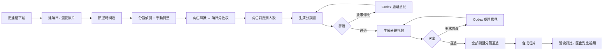

# AniRecast PRD：動漫 OP 角色替換系統

- 狀態：草稿 v0.3，待你審閱（§11 還有 5 個問題待決定；Q3、Q5 已定案）
- 平台：macOS 先做（MVP）；Windows 列為 M7。Workspace 格式從第一天起就跨平台。
- 日期：2026-10-24
- 相關文件：[design.md](design.md)（技術設計）、[research/gemini-api-spike.md](research/gemini-api-spike.md)（模型實測）、[research/codex-dispatch-visibility.md](research/codex-dispatch-visibility.md)（Codex 派發實測）

## 1. 一句話

給一個影片連結，系統把動漫 OP／經典片段下載下來。你節選時間段後，系統拆出分鏡、認出角色，再把角色換成你素材庫裡的人設。以分鏡為單位先生成分鏡圖、再生成分鏡視頻，每一步都由你評審，意見交給 Codex 修正後重新生成。全部分鏡通過後合成成片，並提供左右滑塊對比。

## 2. 目標與非目標

**目標**

- G1 從「貼連結」到「成片 + 對比」的完整流程都在本機一套系統內完成。
- G2 分鏡圖與分鏡視頻都有人工評審關卡；評審意見能交給 Codex 處理並重新生成，直到通過為止。
- G3 Codex 可以只透過 CLI 完成所有操作；Web 介面負責瀏覽、節選、評審、對比。
- G4 Workspace 資料夾可以整包複製到另一台裝了 AniRecast 的電腦，打開就能接著做。

**非目標（MVP 不做）**

- 多人協作、帳號、雲端同步、部署到網路上。
- 改動配樂、歌詞、配音。成片一律保留原片音軌。
- 自訓練模型（LoRA 等）、手機版介面。
- 完全不經人工確認的全自動批次換人。

## 3. 使用者與角色

| 角色 | 做什麼 |
| --- | --- |
| 你（Web） | 看原片、節選、確認分鏡與角色表、選人設、評審分鏡圖和分鏡視頻、看成片對比 |
| 你（Codex 對話） | 用自然語言下指令，例如「下載這個連結」「截 1:23–1:53」「全部分鏡圖先生成一輪」「處理我剛剛的評審」 |
| Codex（agent） | 透過 `anirecast` CLI 執行操作；讀評審意見、修改提示詞與參考圖、觸發重新生成，並先自己看一遍結果 |
| AniRecast 系統 | 負責所有模型呼叫、ffmpeg 處理、檔案版本、任務佇列和成本帳本 |

## 4. 名詞

| 名詞 | 定義 |
| --- | --- |
| Workspace | 一個符合規範的資料夾，裝著全部資料（素材庫、下載合集、項目、資料庫）。可以整包搬到別台電腦 |
| 來源影片（Source） | 下載回來的完整影片，放在「下載合集」裡，可以給多個項目共用 |
| 項目（Project） | 一次換角創作。綁定一部來源影片 |
| 節選（Clip） | 項目選定的時間段。確認後才進入分鏡模式 |
| 分鏡（Shot） | 節選中兩個剪接點之間的連續畫面，以幀為單位記錄起訖 |
| 代表幀 | 每個分鏡用來生成分鏡圖的那一幀，預設取中間幀，可以改選 |
| 片中角色（Cast） | 項目層級的角色表，例如「黑長髮女生」。同一角色在所有分鏡裡共用一筆 |
| 人設（Persona） | 公共素材庫裡的人物，包含參考圖和描述 |
| 角色對應 | 片中角色 → 人設，或設為「不替換」 |
| 分鏡圖（Board） | 用 Nano Banana 2.1 把代表幀換好人的靜態圖，有多個版本 |
| 分鏡視頻（Take） | 用 Gemini Omni 把該分鏡換好人的影片，有多個版本 |
| 關鍵分鏡 | **我的理解：至少有一個「要替換」角色的分鏡。** 沒有要替換角色的分鏡直接沿用原片，不花錢（見 Q1） |
| 成片（Render） | 所有分鏡（換過的 + 沿用原片的）接回去、配上原音軌的完整影片 |

## 5. 端到端流程

分鏡之間互相獨立，可以並行推進。例如分鏡 3 在評審視頻時，分鏡 7 還在改分鏡圖。

## 6. 功能需求

優先級：P0 = MVP 必須，P1 = MVP 後第一批，P2 = 之後再說。

### F1 Workspace 與檔案管理（P0）

- 啟動時選擇 Workspace：**新建**（選一個空資料夾）、**打開**（選既有資料夾並驗證規範），或從最近使用的清單打開。
- Workspace 內建這些區塊：公共素材庫、下載合集、項目（含節選、分鏡、分鏡圖、分鏡視頻、完成的分鏡視頻、成片、對比視頻）。資料夾規範見 design.md §4。
- 打開時檢查規範版本：舊版本先備份再自動遷移；比系統還新的版本拒絕開啟並提示升級。
- 匯出：產生一份一致的 Workspace 副本（可選 zip），排除可重建的快取。
- 另一台電腦打開匯出的 Workspace 後，可以繼續評審、生成、合成，不需要重新下載或重新生成。
- API key 等密鑰**永遠不寫進 Workspace**，各台電腦自己設定。
- 同一個 Workspace 同一時間只能被一個 AniRecast 開啟，以鎖檔防止兩台電腦同時寫入。
- **Workspace 也是 Codex 的工作專案**：
  - 建立 Workspace 時，系統在根目錄寫一份 `AGENTS.md`，告訴 Codex 如何用 `anirecast` 操作這個 Workspace。
  - 每台電腦第一次使用時，要在 Codex 桌面端把 Workspace 資料夾加為專案（只需一次），系統會提示這一步。加入之後，你在桌面端跟 Codex 說「下載這個連結」就能直接操作，自動派發的 thread 也會出現在這個專案底下。
- **檔名跨平台**（因為資料夾會在 Mac 和 Windows 之間搬）：Workspace 內系統產生的檔名與資料夾名一律使用 ASCII slug 或 ULID；避開 Windows 保留名稱（CON、NUL、COM1…），不以點或空白結尾，不會有只差大小寫的兩個名稱；不使用符號連結。中文名稱只存在資料庫裡。

驗收：
- [ ] 新建 → 加一部影片 → 建項目 → 關閉；把整個資料夾複製到另一個路徑（模擬另一台電腦）打開，所有項目、版本、評審記錄都在，播放和合成正常。
- [ ] 打開一個缺少 manifest 或結構不符的資料夾時，系統拒絕並指出原因，不修改任何檔案。
- [ ] Workspace 內搜不到 API key。
- [ ] 在 Mac 建立的 Workspace 複製到 Windows（M7）後可以直接打開，不需要改名或修路徑。

### F2 萬能下載器（P0）

- 輸入連結（YouTube、Bilibili、Niconico、X 等 yt-dlp 支援的網站），下載最佳畫質影片和音訊，合併成單一檔案，同時保存標題、上傳者、原始連結、時長等中繼資料。
- 下載以背景任務進行，Web 和 CLI 都看得到進度；可以取消；失敗時顯示原因（例如需要登入、地區限制）。
- 下載合集頁可以瀏覽、搜尋、刪除（先進垃圾桶），並從任一影片建立項目。
- 同一網址重複下載時提示已存在。
- `anirecast doctor` 檢查 yt-dlp 和它在 YouTube 需要的 JS runtime（deno）是否存在、是否過舊，並提供一鍵更新。

驗收：
- [ ] 貼一個 YouTube 連結，下載完成後下載合集出現該影片，附縮圖、標題、時長，可以播放。
- [ ] Codex 執行 `anirecast source add <url> --wait` 拿到結構化 JSON 結果。

### F3 項目、原片瀏覽與節選（P0）

- 項目頁可以播放原片，具備逐幀前進／後退、跳到指定時間碼、顯示時間碼和幀號。
- 在時間軸上設定入點／出點，或直接輸入時間碼。Codex 也可以用 CLI 設定，例如你在對話裡說「截 1:23.5 到 1:53」。
- 「確認節選」後，系統輸出逐幀精確的節選檔與 Web 播放用的代理檔，並進入分鏡模式。
- 已有分鏡或生成結果時要修改節選，必須明確確認；系統說明哪些結果會失效。舊結果保留成歷史，不刪除。

驗收：
- [ ] 節選的第一幀和最後一幀與設定的入點／出點一致（逐幀比對）。
- [ ] Web 設定和 CLI 設定的節選結果完全相同。

### F4 分鏡偵測與編輯（P0）

- 確認節選後自動偵測剪接點，列出分鏡清單：序號、起訖時間碼與幀號、長度、首／中／尾縮圖。
- 能處理動漫常見的硬切、閃白、快速淡入淡出；靈敏度可以調整後重跑。
- 手動修正：拆分（在某一幀切開）、合併相鄰分鏡、拖動邊界、標記「排除」（例如純黑幀、純字卡）。
- 每個分鏡可以播放原片段，也可以改選代表幀。
- 超過 10 秒的分鏡會自動標示，生成時拆成多段。這是 Omni 的輸入上限，見 §8。

驗收：
- [ ] 一段 90 秒的 OP 在一分鐘內完成偵測。
- [ ] 拆分／合併後，所有分鏡的幀範圍首尾相接、不重疊、不遺漏，加總等於節選的總幀數。

### F5 角色辨識與項目角色表（P0）

- 對每個分鏡的關鍵幀做視覺分析，列出畫面裡的人物：外觀描述、位置框、顯眼程度，並附一句分鏡描述（景別、運鏡、動作）。
- 系統把各分鏡的偵測結果歸併成**項目角色表**，每個角色有代表縮圖和出場分鏡清單。
- 你可以重新命名、合併兩個角色（系統誤拆時）、拆開（系統誤併時）、手動在某分鏡加入或移除某角色。
- 一個角色都沒有的分鏡自動歸為「沿用原片」，你可以手動改回來。

驗收：
- [ ] 角色表裡每個角色都能點開，看到所有出場分鏡和對應的位置框。
- [ ] 修改角色表後，各分鏡的「要不要替換」狀態即時更新。

### F6 公共素材庫：人設（P0）

- 素材庫屬於 Workspace，所有項目共用。
- 每個人設包含：名稱、文字描述（外觀、服裝、特徵）、標籤，以及 1–5 張參考圖。建議至少包含正面全身和臉部特寫，並可標記哪張是主圖。
- 可以新增、編輯、封存人設；匯入圖片時自動產生縮圖。
- P1：從一張圖自動生成多角度人設表（Nano Banana）；把人設轉成跟原片一致的畫風（見 Q2）。

驗收：
- [ ] 在 Web 新增一個人設、上傳 2 張圖；Codex 用 `anirecast persona list --json` 看得到。

### F7 角色對應（P0）

- 在角色表把每個片中角色指定到一個人設，或設為「不替換」。
- 預設以項目為單位套用到所有分鏡；個別分鏡可以覆寫，例如某一鏡不換，或換成另一個人設。
- 改動對應後，受影響分鏡已通過的結果標示為「已過期」，不自動刪除，由你決定要不要重做。

驗收：
- [ ] 設定 A→人設甲、B→不替換後，關鍵分鏡清單正確，只包含有 A 出場的分鏡。

### F8 分鏡圖生成與評審（P0）

- 以分鏡為單位生成：輸入代表幀、對應人設的參考圖和提示詞，用 **Nano Banana 2.1** 生成換人後的分鏡圖。可以生成單一分鏡，也可以一鍵把全部關鍵分鏡排進佇列。
- 生成前顯示預估成本；你可以為一次批次設定預算上限。
- 評審畫面：同一分鏡並排顯示原代表幀與新分鏡圖，下方是版本歷史。
- 評審動作：**通過**、**要求修改（必填意見）**、**直接重生**（不改提示詞再抽一次）、**此鏡沿用原片**。
- P1：在圖上框選區域並針對該區域寫意見；手動上傳自己修過的圖作為一個版本。
- 每個版本記錄當時的提示詞、模型、參數、輸入檔案、成本、是誰觸發（你、Codex 或系統），可以回溯比對。

驗收：
- [ ] 一個分鏡可以經歷「生成 → 要求修改 → Codex 修改 → 新版本 → 通過」，所有版本和意見都保留。
- [ ] 分鏡圖未通過前，該分鏡不能生成視頻（CLI 也會被擋，除非明確加上強制參數）。

### F9 分鏡視頻生成與評審（P0）

- 分鏡圖通過後，輸入「原分鏡影片 + 通過的分鏡圖 + 人設參考圖 + 提示詞」，用 **Gemini Omni** 的影片編輯模式生成換人後的分鏡視頻。
- 生成結果必須與原分鏡**幀數完全一致**；系統自動做幀率、解析度對齊，並丟棄生成的音軌。
- 超過 10 秒的分鏡拆段生成，再接回去；接縫處的處理見 design.md §7。
- 評審畫面：原分鏡與新版本同步播放，支援左右滑塊對比、逐幀檢視、循環播放。評審動作與 F8 相同。

驗收：
- [ ] 通過的分鏡視頻幀數 = 原分鏡幀數，替換回成片時不產生音畫錯位。
- [ ] 任何生成失敗（例如被內容過濾擋下）都在 Web 上顯示原因，該分鏡停在可重試狀態，不影響其他分鏡。

### F10 評審意見自動交給 Codex（P0，Q5 已定案：自動派發）

- 你在 Web 按下「要求修改」後，系統建立一筆 **Agent 任務**，內容包含：哪個分鏡、哪個版本、你的意見、P1 起還有框選區域。
- **自動派發**：系統透過本機 Codex 的 app-server 介面，把任務交給 Codex，不需要你另外開 Codex 下指令。
  - 不用 `codex exec`：它產生的 session 不會出現在 Codex 桌面端的清單裡（實測）。
  - 每個分鏡對應一個 Codex thread，命名為「AniRecast · <項目> · <分鏡>」。同一分鏡的每一輪意見都接在同一個 thread 裡，你在 **Codex 桌面端**可以看到這個分鏡從頭到尾的處理過程，也可以接著跟 Codex 對話。
  - thread 的工作目錄是 Workspace 根目錄，所以會出現在 F1 提到的 Workspace 專案底下。
- **安全邊界**：派發出去的 Codex 在沙箱裡執行，關閉網路，只能寫 Workspace。所有模型呼叫和下載都由 AniRecast 系統執行，Codex 拿不到 API key，也無法自己打 API。
  - 一次只處理一筆任務，其餘排隊。
- Codex 收到任務後：理解意見 → 修改提示詞或參考圖 → 透過 CLI 觸發重新生成 → 自己先看一遍結果 → 回報一句說明（例如「頭髮改成銀色，並加強逆光描述」）。這句說明顯示在 Web 的版本歷史上，並且**存在 Workspace 裡**，換電腦也看得到。
- Codex 認為意見不明確時，把任務標為「需要你回覆」，在 Web 上提出問題。你回答之後，任務自動繼續。
- **即時進度在 Web 看**：Web 逐字顯示 Codex 正在做什麼。分鏡卡片上有「在 Codex 打開」按鈕，可以跳到桌面端的那個 thread。
  - 桌面端主要用來在處理完之後回看或接續對話；**處理中不要在桌面端對同一個 thread 發訊息**。
- **手動模式仍然保留**：你也可以在任何 Codex 對話裡說「處理評審」，Codex 用 `anirecast tasks next` 處理。設定裡可以暫停自動派發。
- **多台電腦**：每台電腦用自己登入的 Codex。Codex thread 只存在該台電腦上；換一台電腦時，系統用 Workspace 裡的評審記錄為分鏡開一個新 thread，處理不會中斷。

驗收：
- [ ] 在 Web 送出一筆意見後，不需要任何手動操作，Codex 就開始處理；Web 即時顯示進度；完成後出現新版本和 Codex 的說明。
- [ ] 同一分鏡第二次送出意見時，Codex 接在同一個 thread 裡處理，並且看得到前一輪的內容。
- [ ] 在 Codex 桌面端的清單裡看得到「AniRecast · …」thread，點進去是完整的處理過程。
- [ ] 把 Workspace 複製到另一台電腦後送出意見，系統在那台電腦的 Codex 開新 thread 並正常完成。Web 上仍然看得到所有歷史說明。
- [ ] Codex 沒安裝、沒登入，或設定的模型不支援時，Web 顯示具體原因，任務留在佇列中，不會靜默失敗。

### F11 合成（P0）

- 把每個分鏡的「通過版本」或「原片」按順序接起來，配上節選的原音軌，輸出成片。
- **草稿合成**隨時可以做：未通過的關鍵分鏡用最新版本或原片代替，並在畫面角落標示「草稿」。**正式合成**要求所有關鍵分鏡都已通過或改為沿用原片。
- 成片有版本記錄，並保存當時每個分鏡用的是哪個版本。

驗收：
- [ ] 成片總幀數與節選完全相同，音軌與原片逐幀對齊。

### F12 對比（P0）

- 成片頁提供**互動滑塊對比**：原片與成片疊在同一畫面，中間一條可拖動的豎線，左邊是原片、右邊是成片。播放時兩邊保證逐幀同步。
- 另外可以匯出一支**對比影片檔**（左右並排，附原音軌），方便分享。
- 同一個滑塊元件也用在 F9 的單一分鏡評審。

驗收：
- [ ] 播放、暫停、拖動進度條、逐幀前進時，左右兩邊永遠是同一幀。

### F13 任務中心與成本（P0）

- 所有長時間工作（下載、偵測、生成、合成）都是背景任務：可以看狀態、進度、錯誤，可以取消，可以重試。
- 成本帳本：每次模型呼叫記錄模型、用量、金額。可以看單一項目、單一分鏡的累計花費。
- Codex 用量：自動派發會消耗你的 ChatGPT／Codex 額度。每次處理記錄 token 用量，Web 顯示目前的額度狀態。額度用完時暫停派發並提示。

### F14 CLI 與 Codex Skill（P0）

- 提供 `anirecast` CLI，**Web 能做的操作 CLI 都能做**，只有「用眼睛評審」除外。Codex 可以看圖，但通過與否的最終決定由你在 Web 做。
- 輸出規範：stdout 只輸出一個 JSON 物件，進度寫到 stderr；長任務支援 `--wait` 和 `jobs watch --jsonl`。
- 提供 Codex skill：教 Codex 這套流程、指令和評審規則，安裝到 `~/.codex/skills/anirecast/`。
- 為什麼選 CLI 而不是 MCP：見 design.md §8。P2 可以再加一個薄的 MCP 轉接層。

驗收：
- [ ] 在一個全新的 Codex 對話中只說「用 anirecast 把這個連結做到出分鏡清單」，Codex 能自己完成下載、建項目，並在你給時間段後完成節選和分鏡偵測。

### F15 設定與環境檢查（P0）

- 每台電腦各自的設定（API key、預設模型、併發數、Codex 自動派發開關）存在本機使用者設定目錄，不在 Workspace 裡。
- **AniRecast 服務開機自動啟動**：Mac 用 launchd，Windows 在 M7 處理。CLI 發現服務沒在跑時，直接回報「AniRecast 沒在執行」並說明怎麼啟動。CLI 不會自己在背景啟動服務：從 Codex 沙箱裡啟動的服務會被沙箱限制，連不到模型 API。
- `anirecast doctor` 檢查以下項目，缺什麼就給出修正方式：
  - Node、ffmpeg、Python 環境、yt-dlp、deno；
  - API key 是否有效、模型是否可用；
  - AniRecast 服務是否在執行；
  - 找到哪個 codex、版本多少，並實際跑一輪探測、顯示錯誤原文；
  - Workspace 根目錄有沒有 `AGENTS.md`；是否已加入 Codex 桌面端專案（盡力檢查，檢查不到時提示手動確認）。

## 7. 非功能需求

- **本機、單人**：服務只監聽 localhost。
- **可攜**：Workspace 內的所有路徑都是相對路徑；資料庫在 Workspace 內；密鑰不在 Workspace 內。
- **可重現**：每個生成產物都記錄完整的輸入（檔案雜湊、提示詞、模型、參數）。雲端的檔案 ID、多輪對話 ID 只當快取。前者約 48 小時就過期，所以換一台電腦之後，一定能從本機檔案重新發起同樣的請求。
- **不破壞**：來源影片和節選檔不會被修改；版本只會增加；刪除先進垃圾桶。
- **成本可見**：生成前顯示預估；批次可設上限；帳本可以查詢。
- **不卡介面**：所有超過 1 秒的工作都走背景任務；Web 用 SSE 即時更新。

## 8. 已驗證的模型能力（摘要）

詳見 [research/gemini-api-spike.md](research/gemini-api-spike.md)。用你的 key 實測，花費約 USD 1.6：

- `gemini-nano-banana-2.1` 換人：約 24 秒／張，構圖、光影、畫風都保留，人設特徵正確。
- `gemini-omni-1.1-flash` 影片編輯：上傳 4 秒原分鏡加上分鏡圖和人設圖，輸出**幀數與輸入完全一致**（96→96）。動作、時機、運鏡、背景都保留，約 60 秒完成。
- 編輯成本約 USD 0.11／秒（720p），跟分鏡長度成正比。
- 限制：上傳的影片必須 ≤10 秒；輸出比例只有 16:9 或 9:16；輸出會附音軌，合成時丟掉；可辨識的真人有限制。
- **尚未驗證**（M0 處理）：真實 OP 的版權角色會不會被擋、23.976fps 輸入、<1 秒的分鏡、多人同框、OP 上的字幕文字、1080p 的價格。

## 9. 成本估算（每部作品）

假設：90 秒 OP、約 40 個分鏡、其中 28 個是關鍵分鏡（合計約 63 秒），每個關鍵分鏡的分鏡圖和分鏡視頻平均各來回 3 次。

| 項目 | 計算 | 約 |
| --- | --- | --- |
| 分鏡圖 | 28 × 3 × USD 0.05（2K） | USD 4 |
| 分鏡視頻 | 63 秒 × 3 × USD 0.11 | USD 21 |
| 角色辨識、分析 | Flash 系列模型 | < USD 0.5 |
| **合計** | | **約 USD 25**（全部 40 鏡都要換時約 USD 35） |

1080p／4K 的價格待 M0 確認。

## 10. 里程碑

| 里程碑 | 內容 | 驗收重點 |
| --- | --- | --- |
| **M0 真實片段驗證** | 用你挑的一段真實 OP（約 15 秒、5–8 個分鏡），以腳本跑完下載 → 分鏡 → 換人 → 合成 | 確認 §8 的未驗證項；不通過的項目要先調整設計（約 USD 5） |
| M1 骨架 | Workspace、下載器、項目、原片瀏覽、節選、分鏡偵測與編輯；CLI、Web 和 Codex skill 的骨架 | F1–F4、F13、F15 |
| M2 角色 | 角色辨識、角色表、素材庫、角色對應 | F5–F7 |
| M3 分鏡圖 | 生成、評審、Agent 任務、Codex 自動派發（含手動模式） | F8、F10 |
| M4 分鏡視頻 | Omni 編輯、對齊、評審、單鏡滑塊對比 | F9、F12（單鏡部分） |
| M5 成片 | 合成、成片對比、對比影片匯出、Workspace 匯出 | F11、F12 |
| M6 強化 | 圖上框選意見、人設表生成與畫風轉換、MCP 轉接層 | 依使用回饋排序 |
| M7 Windows | 在 Windows 上安裝與執行：ffmpeg、Python、yt-dlp、deno 的安裝方式；服務開機啟動；桌面版內建 codex 的路徑；Windows 的 Codex 沙箱行為（SQLite 通訊是否仍可用）；`codex://` 連結能否打開；從 Mac 搬來的 Workspace 能否直接打開 | Mac 與 Windows 互相搬 Workspace 都能繼續工作 |

## 11. 需要你決定的問題

1. **Q1「關鍵分鏡」的定義**：我理解成「有要替換角色的分鏡」，其餘沿用原片。還是你指的是「從所有分鏡裡挑幾個重點分鏡來做」？
2. **Q2 人設來源**：素材庫只放動漫風格的人設，還是也要放真人照片，再由系統先轉成跟原片一致的畫風？Omni 對「可辨識的真人」有限制，如果要用真人照片，這一步幾乎是必要的。
3. ~~Q3 其他電腦的作業系統~~ **已定案（2026-10-24）**：Mac 和 Windows 都要。先做 Mac；Windows 列為 M7。Workspace 格式從第一天起就跨平台（見 F1）。
4. **Q4 成片解析度**：Omni 原生輸出 720p，1080p 是官方放大。原片多半是 1080p，選 720p 時成片統一 720p；選 1080p 時換過的分鏡會比沒換的略軟。你要哪一種？
5. ~~Q5 Codex 交接模式~~ **已定案（2026-10-24）**：MVP 就做自動派發，透過 Codex app-server，讓 session 出現在桌面端。手動模式保留作為備用。見 F10。
6. **Q6 Workspace 預設位置**：例如 `~/AniRecast-Workspace/`。專案原始碼在 `~/Documents/lien/AniRecast/`，兩者會分開。
7. **Q7 OP 字幕**：OP 常有工作人員名單和片名字，換人時要盡量保留原字（預設），還是也要能去掉？

## 12. 風險

| 風險 | 影響 | 對策 |
| --- | --- | --- |
| 版權角色或內容被模型過濾 | 某些分鏡做不出來 | M0 先驗；被擋的分鏡可以改提示詞、改用圖生視頻，或沿用原片 |
| 幀率／幀數不一致 | 音畫錯位 | 生成時統一成固定幀率上傳，回來後逐幀校驗，不一致就自動標紅並且不讓它通過 |
| 多人同框換錯人 | 身份混亂 | 提示詞帶位置與外觀描述；分鏡圖先過人工審核，作為影片的視覺錨點 |
| 長分鏡拆段後接縫跳動 | 畫面不連續 | 以前一段尾幀作為下一段的參考；必要時接受在剪接點換段 |
| yt-dlp 跟 YouTube 的變動 | 下載失敗 | `doctor` 檢查版本並一鍵更新 |
| 模型 ID 或 API 變動 | 生成中斷 | 模型 ID 寫在設定裡；呼叫集中在一個供應商轉接層 |
| 成本失控 | 超支 | 預估、批次上限、帳本 |
| 版權與平台條款 | 法律風險 | 定位為個人創作工具；下載與成品使用由使用者自行負責 |
